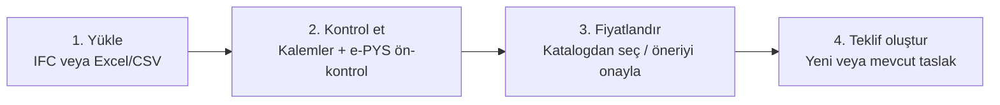

# TeklifPro / BIMPlan Academy — UI/UX Değerlendirmesi ve Öneriler

**Tarih:** 8 Ekim 2026
**Bakış açıları:** BIM Knowledge Engineer · BIM Software Architect · Modern Web Guidance · Design System (görsel denetim + "AI slop" kontrolü)
**Yöntem:** Kod tabanının salt-okunur taranması. Rota, menü ve sayfa yapısı incelendi; renk, yazı ve bileşen kullanımı grep ile sayıldı. Bu rapordaki **her sayı bir komut çıktısından gelir.**
**Sınır:** Sayfalar tarayıcıda görsel olarak gezilmedi. Port 3000'i başka bir süreç (Docker) tutuyor, ona dokunulmadı. Bu yüzden değerlendirme kod ve yapı üzerinden yapıldı. Uygulamaya geçmeden önce 3–5 gerçek kullanıcıyla kısa bir görev testi öneriyorum.

---

## 1. Teşhis: neden karmaşık hissettiriyor?

Sorun tek bir ekranda değil. **Beş yapısal nedenin** birleşiminden kaynaklanıyor:

| # | Kök neden | Kanıt |
|---|---|---|
| 1 | **Aynı işi yapan birden fazla yol var** | IFC dosyası iki ayrı yerden yüklenebiliyor: `/app/ifc-parser` ("5D IFC Metraj Engine") ve `/app/smartcheck`. Bu iki yol teklife farklı yollarla gidiyor. Teklif sayfasındaki "IFC yükle" butonu inceleme yapılmayan yola gidiyor (`CreateQuote.tsx:342`). Akademi **6 farklı girişe** dağılmış. Aynı ders sayfası iki rotada açılıyor (`App.tsx:113,116`). |
| 2 | **Menü kullanıcının işine göre değil, ekibin iç yapısına göre düzenlenmiş** | 15 menü öğesi var. "Kalite" grubunda birbiriyle ilgisiz beş iş bir arada: IFC aracı, SmartCheck, Piyasa Verisi, Mevzuat, Pilot Kanıtı. İç operasyon sayfaları ("Pilot Kanıtı", "Pilot Başvuruları") son kullanıcıya görünüyor. |
| 3 | **Ana iş akışı tek bir uzun sayfaya yığılmış** | SmartCheck sayfası: 851 satır, 32 `useState`, 23 buton, yaklaşık 6 aşama, 20'den fazla kontrol. Adım göstergesi yok. CSV katalog kartı duruma göre iki farklı yerde çıkıyor. Pilot kayıt formu (7 alan) normal kullanıcının yolunda duruyor. |
| 4 | **Arayüz dili geliştirici dili** | Kullanıcı ekranda şunları görüyor: "Evidence-first pilot", "Backend sadece IFC property/QTO…", "Worker tamamlandığında", "Tenant içindeki… run", "advisory", "Snapshot seç", "Retry", ham durum kodları (`failed`, `succeeded`), "high IMPACT". SmartCheck dosyasında "snapshot" 54, "review" 32 kez geçiyor. |
| 5 | **Görsel sistem "her şey önemli" diye bağırıyor** | Uygulama genelinde 860 adet sabit piksel yazı boyutu var (`text-[10px]` 462, `[9px]` 177, `[8px]` 113, `[7px]` 7). Bunlara ek olarak 504 `font-black`, 684 `uppercase`, 417 `tracking-widest`. Gövde metinlerinde WCAG kontrast eşiğinin altında kalan gri tonlar kullanılıyor (aşağıda). Hiyerarşi kayboluyor. |

---

## 2. Design System görsel denetimi (10 boyut)

Puanlar kod kanıtına dayanan uzman değerlendirmesidir. 0 = çok kötü, 10 = örnek seviyesi.

| Boyut | Puan | Kanıt | Düzeltme |
|---|---:|---|---|
| Renk tutarlılığı | 4 | 2 nötr aile birlikte kullanılıyor (zinc 2151, slate 538). 10 vurgu ailesi var: orange 856, emerald 388, amber 199, red 142, sky 78, blue 70, purple 39… SmartCheck tek ekranda 5 buton rengi kullanıyor. 4 sabit hex arka plan var (`#09090b`, `#0c0c0e`…), hiçbiri token değil. | Tek nötr (zinc). Tek marka vurgusu (turuncu). 4 anlamsal renk: başarı, uyarı, hata, bilgi. Hex'leri token'a çevir. |
| Tipografi hiyerarşisi | 2 | 860 sabit piksel boyutu, 7–11 px aralığı yaygın. Menü etiketleri 9–10 px siyah büyük harf (`Shell.tsx:31,42`). Public sayfalar `font-semibold` başlık kullanıyor, `/app` ise `font-black uppercase`. Aynı marka için iki ayrı tip sistemi. | 6 kademeli tip ölçeği (§4.2). **En küçük boyut 12 px**, gövde 14–16 px. |
| Boşluk ritmi | 6 | Tailwind boşluk ölçeği büyük ölçüde kullanılıyor. Sorun yoğun panellerde ritmin kaybolması. | Sayfa, bölüm ve kart için 3 sabit boşluk kuralı. |
| Bileşen tutarlılığı | 4 | Hazır bileşenler yerine ham etiketler: ham `<button>` 105 (`Button` 161), `<input>` 47 (`Input` 69), `<select>` 15 (`Select` 6), `<textarea>` 5 (`Textarea` 0). 7'den fazla köşe yuvarlaklığı değeri aktif kullanımda. | Ham kontrolleri `components/ui` bileşenleriyle değiştir. Köşe yuvarlaklığını 3 değere indir (sm, md, lg). |
| Duyarlı davranış | 5 | Mobil menü ve skip link mevcut. Ancak dar ekranda yalnızca ikon kalan butonların etiketi yok (`Shell.tsx:161-163`). Silme butonları yalnızca hover'da görünüyor, dokunmatik ekranda erişilemiyor. | Tüm butonlarda erişilebilir ad. Hover'a bağlı görünürlüğü kaldır. |
| Tema | 5 | Uygulamanın çoğu koyu. `CompleteAcademyContent` açık temada, `bimplan/*` modülleri slate tonlarında. Tema seçimi bilinçli değil, parça parça oluşmuş. | Tek bir tema kararı ver (§4.4). |
| Animasyon | 6 | Sınırlı. 18 bulanık arka plan "blob" efekti, 9 gradyan, nabız atan nokta. | Dekoratif efektleri kaldır, yalnızca durum geçişlerinde animasyon kullan. |
| Erişilebilirlik | 4 | 7 ikon butonda `aria-label` yok. Dokunma hedefleri 16–24 px (`CRM.tsx:169,193,196`). Koyu arka planda `text-zinc-500` kontrastı ≈4.1:1, 381 kullanım, küçük metinde AA'yı geçmiyor. `zinc-600` ≈2.6:1 (109 kullanım), `zinc-700` ≈1.9:1 (14). Olumlu: skip link, `aria-current` ve form etiketleri mevcut. | Gövde metninde en az `zinc-400`. En az 44–48 px dokunma hedefi. Tüm ikon butonlara `aria-label`. |
| Bilgi yoğunluğu | 3 | SmartCheck'te tek sayfada 6 aşama. Teklif sayfasının başlığında eşit ağırlıkta 4 buton var. Altında yapay zekâ sihirbazı, kalem tablosu ve ayarlar paneli aynı anda görünüyor. | Adım adım akış ve "gelişmiş" alanların gizlenmesi (§3). |
| Cila | 5 | Boş ve hata durumları kısmen var (404, ErrorBoundary). Durum rozetleri ham kod gösteriyor. Türkçe büyük harf hataları: "Yenİ" (`CRM.tsx:256`), "Adresİ" (`Login.tsx:95`, `Register.tsx:100`). Emoji ikon olarak kullanılıyor (12 dosya). | Ortak bir `StatusBadge` bileşeni ve Türkçe durum sözlüğü. Metin içine büyük harf yazmak yerine CSS `uppercase` kullan. |

**"AI slop" kontrolü:**

- **Tespit edilenler:** gradyan dolgulu başlık metni (yeni landing'de kaldırıldı); dekoratif bulanık blob'lar; emoji seviye işaretleri (🟢🟡🔵, kaldırıldı); her şeyin büyük harf ve kalın yazılması; anlamsız "glass" kartlar (`backdrop-blur` kartlar, landing'de kaldırıldı).
- **Henüz temizlenmeyenler:** `/app` içi ve Academy sayfaları.

---

## 3. Önerilen bilgi mimarisi

### 3.1 Menü: 15 öğeden 6 öğeye

Ana ilke: **kullanıcının yaptığı işe göre grupla, ekibin iç modüllerine göre değil.**

| Yeni menü | Neyi kapsıyor | Bugünkü karşılığı |
|---|---|---|
| **Ana Sayfa** | Bekleyen işler: incelemedeki dosyalar, süresi dolan teklifler, son teklifler | Dashboard |
| **Dosyadan Teklif** | IFC/Excel yükle → kontrol et → fiyatlandır → teklif oluştur. **Tek akış.** | SmartCheck + IFC Metraj Engine + e-PYS ön-kontrol (yeni) |
| **Teklifler** | Liste, yeni teklif, teklif detayı, PDF, kârlılık sekmesi | Teklifler + Kârlılık |
| **Müşteriler** | Müşteri listesi + fırsatlar (pipeline) sekmesi | Müşteriler + CRM Pipeline |
| **Fiyat Kataloğu** | Kendi birim fiyatlarım, CSV içe aktarma, piyasa verisi sekmesi | SmartCheck içindeki katalog kartı + Piyasa Verisi |
| **Akademi** | Tek merkez: kulvarlar, dersler, sözlük, standartlar, sınav, sertifika | 6 farklı Akademi girişi |

**Menüden çıkacaklar:**

| Öğe | Yeni yeri |
|---|---|
| Ayarlar | Sol alt köşedeki kullanıcı menüsü |
| AI Asistan | Ayrı sayfa olmaktan çıkar, teklif ve dosya ekranlarında bağlam içi yardımcı olur |
| Mevzuat | "Dosyadan Teklif" içinde e-PYS ön-kontrol sonuçları + Akademi'de mevzuat kulvarı |
| Pilot Başvuruları, Pilot Kanıtı | Yalnızca `admin` rolüne görünen **Yönetim** alanı |
| Demo sayfaları (`smartcheck/checks/demo` vb.) | Landing veya Akademi'deki tanıtıma taşınır, uygulama menüsünden çıkar |

### 3.2 "Dosyadan Teklif" sihirbazı (en yüksek etkili değişiklik)

IFC ve Excel dosyaları aynı 4 adımdan geçer. `/app/ifc-parser` ayrı bir araç olarak emekliye ayrılır.

| Adım | Kullanıcı ne görür? | Varsayılanda **gizli** olanlar |
|---|---|---|
| 1. Yükle | Tek bir sürükle-bırak alanı. Excel için sütun eşleme ancak gerekirse açılır ve önceden doldurulmuş gelir. | MEP profili, sheet ve başlık satırı ayarları ("Gelişmiş" altında) |
| 2. Kontrol et | Özet: "160 kalem okundu · 12 kalem kontrol bekliyor · 3 kalem modelde veri olmadığı için hesaplanmadı". Sorunlu kalemler üstte gelir. "Sorunsuzların hepsini onayla" butonu. Satır başına **tek birincil işlem**, diğerleri menüde. İkinci sekme: **e-PYS ön-kontrol** (EK-9 maddeleri). | Ham IFC kimliği, kaynak yolu (satır detay çekmecesinde) |
| 3. Fiyatlandır | "120 kalem için güvenli eşleşme bulundu, uygula" önerisi. Eşleşmeyenler liste halinde. Katalog yoksa: "Kataloğunuzu yükleyin". | Manuel fiyat kaydı formu (satır içi "fiyat gir") |
| 4. Teklif oluştur | Müşteri seç → "Teklif taslağını oluştur". | Pilot kayıt formu (yalnızca admin) |

**Uygulanacak web ilkeleri** (modern-web-guidance `forms` rehberi, §11 "Multi-Page Forms"):

- Adım göstergesi `<nav aria-label="İlerleme">` + `<ol>` ile kurulur. Etkin adımda `aria-current="step"` kullanılır.
- Kullanıcı geri ve ileri gidebilir, adımlar arasında veri kaybolmaz.
- Doğrulama alandan çıkınca (`blur`) yapılır. Yazarken yalnızca hata temizlenir. Gönderimde odak ilk hataya taşınır (rehberdeki "Validation Event Timing Matrix").
- Form girişleri en az 16 px yazı ve 48 px dokunma hedefi kullanır (iOS yakınlaştırma sorununu önler).
- Satır detayları için çekmece (drawer) kullanılır. `inert` arka plan, `Esc` ile kapanma ve odak geri dönüşü sağlanır (`navigation-drawer` ve `html` rehberleri: native `<dialog>` / popover).

### 3.3 Akademi: tek merkez, tek ders rotası

- `/academy`: tüm kulvarlar. Kullanıcı giriş yapmışsa ilerleme de burada görünür.
- `/academy/:kulvar`: kulvar sayfası, alt rehberler bu sayfadaki çekmecede açılır.
- `/academy/:kulvar/:ders`: **tek ders rotası.** Bugünkü `academy/content/:slug` ve `academy/allplan/content/:slug` ikilisi birleşir.
- Sözlük, standartlar, sınav ve sertifika aynı merkezin sekmeleri olur. Bugün bunların menüde girişi yok.
- Public ve giriş yapmış görünüm **aynı görsel kabukta** olur. Bugün iki ayrı kabuk var.

---

## 4. Design system önerisi

### 4.1 Renk rolleri (token)

| Token | Kullanım | Değer (koyu tema) |
|---|---|---|
| `--background` / `--surface` / `--surface-raised` | Sayfa / kart / açılır panel | zinc-950 / zinc-900 / zinc-800 |
| `--text` / `--text-muted` | Gövde / ikincil metin | zinc-100 / **zinc-400** (≈7:1). Gövdede **zinc-500 ve daha koyusu kullanılmaz.** |
| `--primary` | Tek birincil eylem, marka | orange-600 |
| `--success` `--warning` `--danger` `--info` | Yalnızca durum anlatır | emerald / amber / red / sky |

Kural: **bir ekranda tek birincil (turuncu) buton.** Diğer butonlar ikincil (outline veya ghost) olur.

### 4.2 Tip ölçeği

| Rol | Boyut / satır yüksekliği | Ağırlık |
|---|---|---|
| Sayfa başlığı | 24/32 | 600 |
| Bölüm başlığı | 18/28 | 600 |
| Gövde | 14/20 (form girişleri 16) | 400 |
| Etiket / tablo | 13/18 | 500 |
| Yardımcı metin | **12/16 (alt sınır)** | 400 |
| Üst başlık (overline) | 12, `uppercase`, `tracking-wide` | 600. Ekranda en fazla birkaç yerde |

**Lint kuralları:** `text-[<12px]` yasak, `font-black` yalnızca landing hero'da serbest. ESLint kuralı ya da basit bir grep CI kontrolü eklenebilir.

### 4.3 Bileşenler

| Bileşen | Kural |
|---|---|
| `components/ui` | Tek kaynak. Ham `<button>`, `<input>`, `<select>`, `<textarea>` yerine bu bileşenler kullanılır. |
| `StatusBadge` + `statusLabels.ts` | Türkçe durum sözlüğü (§5). Ham durum kodu ekranda gösterilmez. |
| `Stepper` | Sihirbaz için ortak adım göstergesi. |
| `EmptyState`, `ErrorState` | Bileşenler mevcut, tüm listelerde kullanılır. |
| `DetailDrawer` | Satır detayı ve alt rehberler için tek çekmece bileşeni. |

Köşe yuvarlaklığı 3 değerle sınırlanır: sm (kontrol), md (kart), full (rozet). İkonlar yalnızca Lucide setinden gelir, **emoji ikon olarak kullanılmaz.**

### 4.4 Tema kararı

Teklif ve metraj, uzun süre tablo okunan bir iş. Ofis ortamında **açık tema varsayılan** olarak daha az yorucu olabilir. Shadcn token'ları (`:root` / `.dark`) zaten tanımlı, iki tema da desteklenebilir. Önerim:

- Landing ve marka sayfaları koyu kalır.
- `/app` için kullanıcıya tema seçeneği sunulur.
- Karar bir kullanıcı testiyle verilir.

---

## 5. Dil: kullanıcıya görünen metin sözlüğü

*(BIM Knowledge Engineer)*

| Bugün ekranda | Önerilen |
|---|---|
| Evidence / kanıt satırı | Kaynak / kaynaklı kalem |
| pending_review / Review bekliyor | İncelemede |
| approved / accepted_exception / rejected | Onaylandı / Gerekçeyle kabul edildi / Reddedildi |
| Snapshot / Snapshot seç | Fiyat kaydı / Fiyat seç |
| advisory | Öneri (onayınızla geçerli olur) |
| QTO | IFC miktar seti |
| Property / Pset | Model özelliği |
| Geometry blocked / estimate blocked | Modelde veri yok, hesaplanmadı |
| Worker / Backend / Tenant / run | (Kullanıcıya gösterilmez) "Dosyanız işleniyor…" |
| Retry | Tekrar dene |
| failed / succeeded | Başarısız / Tamamlandı |
| high IMPACT | Yüksek etki |
| Dashboard / CRM Pipeline / 5D IFC Metraj Engine | Ana Sayfa / Fırsatlar / Dosyadan Teklif |
| Verified değil | Henüz onaylanmadı |

**Alan terimleri:** LOIN, GUID ve IFC sınıf adları ürün içinde yalnızca detay çekmecesinde ve bir sözlük bağlantısıyla gösterilir. Akademi'de ise birincil içeriktir.

**Mevzuat terimleri** nihai RG metniyle birebir aynı olmalı: `CSBPozNo`, `TREpys_*`, LOD 300, EK-9. Taslak terimleri (`Tr_Pset_CSB`, LOD100–400 aşama tablosu) kullanılmaz (bkz. `E-Proje-Teslim/ozet.md`).

---

## 6. Mimari notlar

*(BIM Software Architect)*

- **SmartCheck sayfasını parçala.** `SmartCheckImportWorkspace.tsx` (851 satır, 32 `useState`, birkaç KB'lık tek satırlık JSX bölümleri) adım bileşenlerine bölünmeli: `UploadStep`, `ReviewStep`, `PricingStep`, `TransferStep`. Durum, bir `useReducer` veya açık bir durum makinesiyle yönetilmeli. Mevcut iş kuralları (kanıt kapıları, kiracı izolasyonu, insan onayı) **aynen korunur**. Değişen yalnızca sunum katmanı.
- **Rota temizliği.** `/about`, `/pricing` ve `/features` aynı LandingPage'i açıyor (`App.tsx:66-69`). Ya gerçek sayfalar yapılmalı ya da ana sayfadaki bölümlere yönlendirilmeli. Ders rotaları birleştirilmeli. Demo rotaları bir feature flag arkasına alınmalı.
- **Rol bazlı menü.** Menü öğelerine `roles: ['owner','admin',…]` alanı eklenmeli. Pilot ve ops sayfaları yalnızca admin'e görünmeli. Yetki kontrolü sunucu tarafında zaten var, bu yalnızca görünürlüğü düzenler.
- **e-PYS ön-kontrol modülü** `src/ifc/` altında saf fonksiyonlar olarak yazılmalı ve sihirbazın 2. adımına bağlanmalı. Kurallar nihai EK-6 ve EK-9'a göre olmalı: proxy yasağı, mekânsal hiyerarşi, `TREpys_*` setleri, isimlendirme.
- **Ölçüm.** Her fazdan önce ve sonra şunlar ölçülmeli:
  - "IFC'den teklif taslağı" görevini tamamlama süresi ve tıklama sayısı
  - Pilot kullanıcının ilk teklifi tamamlama oranı
  - 12 px altı yazı sayısı ve kontrast ihlali sayısı (grep ile, CI'da)

---

## 7. Yol haritası

| Faz | Süre (tahmini) | İçerik | Risk |
|---|---|---|---|
| **1. Hızlı kazanımlar** | ~1 hafta | Menüyü 6 öğeye indir, ops sayfalarını rolle gizle · metin sözlüğünü uygula (§5) · Türkçe büyük harf hatalarını düzelt · ikon butonlara `aria-label` ekle, hover'a bağlı silme butonlarını düzelt · gövde metinlerini `zinc-400`'e çek · 12 px altı yazıları kaldır | Düşük. Davranış değişmez. |
| **2. Dosyadan Teklif sihirbazı** | ~2–3 hafta | 4 adımlı akış · IFC parser'ı akışa entegre et veya emekliye ayır · SmartCheck sayfasını adım bileşenlerine böl · `StatusBadge` / `Stepper` / `DetailDrawer` bileşenleri | Orta. Mevcut entegrasyon testleri korunmalı. |
| **3. Akademi merkezi + design token'ları** | ~2 hafta | Tek merkez ve tek ders rotası · renk, tip ve köşe yuvarlaklığı token'ları · ham kontrolleri bileşenlerle değiştir · tema kararı | Orta |
| **4. e-PYS ön-kontrol** | ~2 hafta | EK-9 maddelerinin otomatik denetimi (sihirbazın 2. adımında) · `TREpys_*` okuyucusu | Orta. Önce nihai ekleri PDF'te teyit et. |

> [!TIP]
> Faz 1 tek başına algılanan karmaşıklığı ciddi biçimde azaltır ve geri alınması kolaydır. İsterseniz buradan başlayıp her adımı ayrı commit olarak ilerletebilirim.
