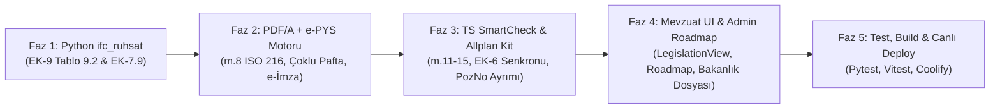

# Bakanlıktan Gelen Son PDF'ler (`05.08.2026 / RG 33331`) — Analiz Raporu ve Uygulama Yol Haritası

> [!IMPORTANT]
> **UYGULAMA DURUMU: TAMAMLANDI (15 Ekim 2026 — Commit `9dd9149`)**  
> Bu dokümanda yer alan **5 Fazlı Uygulama Yol Haritasının tamamı** onayınız doğrultusunda eksiksiz uygulanmış, **53 Python (`pytest`) + TypeScript (`tsx --test`)** birim testlerinden geçmiş, `graphify` bilgi grafiği güncellenmiş ve `https://bimmetraj.com` canlı ortamına deploy edilmiştir.

---

## 1. İncelenen Dosyaların Kimliği ve Kapsamı

| Dosya Adı | Boyut / Sayfa | Resmi Gazete Bilgisi | İçerik Özeti |
| :--- | :--- | :--- | :--- |
| **`#1.pdf`** | 175 KB / 4 Sayfa | **05.08.2026 — Sayı: 33331** | *Mimarlık ve Mühendislik Projelerinin Dijital Olarak Hazırlanması Hakkında Yönetmelik* (Madde 1–17, Geçici Madde 1–2) |
| **`#2.pdf`** | 159 KB / 3 Sayfa | **05.08.2026 — Sayı: 33331** | *Mimarlık ve Mühendislik Projelerinin Elektronik Ortamda Teslimi ve Yönetilmesi Hakkında Yönetmelik* (Madde 1–9, e-PYS süreçleri) |
| **`EKLER.pdf`** | 22.8 MB / 241 Sayfa | **05.08.2026 — Sayı: 33331** | `#1.pdf` Yönetmeliğinin Resmi Ekleri (**EK-1'den EK-9'a kadar** tüm tablolar; kök dizindeki `20260805-2-1.pdf` ile birebir aynı SHA-256 özete sahiptir) |

---

## 2. Kasım 2025 Taslağı (`Taslak`) ile Resmi Gazete (`#1.pdf`, `#2.pdf`, `EKLER.pdf`) Arasındaki Kritik Değişiklikler

Kök dizindeki Kasım 2025 taslak dosyaları ile `bakanlıktan-gelen-son-pdfler` klasöründeki nihai Resmi Gazete metinleri karşılaştırıldığında **9 temel mevzuat farkı** kesinleşmiştir:

1. **DXF Zorunluluğu Kalktı, Yerine PDF/A Geldi (`#1.pdf` m.4, m.8, m.9, Geçici m.1):**
   - Taslakta yer alan `.dxf` teslim zorunluluğu tamamen kaldırılmış; hem 2B projelerde hem de BIM modelinden üretilen 2B paftalarda **PDF/A (ISO 19005)** formatı ve **A4 katları (TS EN ISO 216)** pafta boyutu zorunlu kılınmıştır.
2. **Madde 12 ("Malzemelerde 15 Karakter Sınırı") Ana Yönetmelikten Çıkarıldı ve Madde Numaraları Kaydı (`#1.pdf` m.11–17):**
   - Taslakta `Madde 12` olan *"Malzemelerin isimlendirilmesi (15 karakter sınırı)"* hükmü nihai yönetmelikten çıkarılmıştır.
   - Bu nedenle Taslaktaki **Madde 13 → Madde 12** (IFC sınıfları ve özellik tanımları - EK-5/EK-6), **Madde 14 → Madde 13** (Proje öznitelikleri - EK-7), **Madde 15 → Madde 14** (Model gelişim seviyesi - EK-8) ve **Madde 16 → Madde 15** (Model kalite kontrol formları - EK-9) olmuştur.
   - Malzeme isimlendirme kuralı artık `EKLER.pdf` **EK-6** tablolarındaki `Material` özelliğinde **`Malzeme İsmi_Dayanım`** (örn. `Beton_C25`, `Çelik_S355`) formatıyla tanımlanmaktadır.
3. **Varlık İsimlendirme Ayıracı `_` (Alt Tire) Yerine `-` (Orta Tire) Oldu (`#1.pdf` m.11 & `EKLER.pdf` EK-5.5):**
   - Taslakta `Disiplin_Kategori_Açıklama` olan şablon, nihai metinde **`Disiplin-Kategori-Açıklama`** (orta tire `-`) olarak değiştirilmiştir.
   - `m.11(4)` ile açıklama alanına alt kategori, fonksiyon, ölçü ve malzeme bilgilerinin yanı sıra **mahal numarası ile mahal ismi** girilebilmesi eklenmiştir.
4. **EK-8 (LOD Tabloları) 27 Sayfadan 1 Sayfaya İndirildi (`EKLER.pdf` s.237):**
   - Taslakta 27 sayfa olan eleman bazlı LOD 100/200/300/350/400 tabloları kaldırılmış; nihai `EKLER.pdf` s.237'de **EK-8** tek sayfaya indirilerek yapı ruhsatı eki tüm disiplin modellerinin **"Detaylı Modelleme" (LOD 300)** seviyesinde teslim edileceği hükme bağlanmıştır.
5. **EK-9 Model Kalite Kontrol Formu İkiye Ayrıldı: `Tablo 9.1` (Mimari - 21 Satır) ve `Tablo 9.2` (Diğer Disiplinler - 16 Satır) (`EKLER.pdf` s.238–241):**
   - `EKLER.pdf` s.238 (`9.1` maddesi): *"Teslim edilen mimari disipline ait BIM modeli/modelleri için Tablo 9.1'deki ve diğer disiplinlere ait BIM modelleri için Tablo 9.2'deki Model Kalite Kontrol Formu düzenlenir."*
   - `Tablo 9.2` (s.240–241), Statik (`ST`), Mekanik (`MK`), Elektrik (`EL`) vb. disiplinler için mimariye özgü 5 mahal/emsal satırını (Tablo 9.1'deki 4, 10, 12, 13 ve 14. satırlar) çıkararak **16 satırlık** resmi kontrol formu tanımlamaktadır.
6. **`TREpys_` Özellik Setleri Sadece 2 Adet Olarak Kesinleşti (`EKLER.pdf` EK-6):**
   - `EKLER.pdf` s.35 (`6.5` maddesi): *"Tablo 6.1 ile Tablo 6.135 arasında yer alan `TREpys_` ile başlayan tüm özellik setleri ve altında yer alan özellikler modelde kullanıcı tarafından oluşturulacaktır."*
   - Resmi `EKLER.pdf` içinde sadece **2 adet** `TREpys_` seti vardır:
     1. **`TREpys_ParselOzellikSeti`** (`IfcSite` — Tablo 6.55, s.95): `TAKS`, `KAKS`, `CekmeOn`, `CekmeYan`, `CekmeArka`
     2. **`TREpys_EmsalOzellikSeti`** (`IfcSpatialZone` — Tablo 6.60, s.101): `EmsalDurumu` (`DAHIL` | `HARIC` | `DIGER`)
   - Taslak döneminde konuşulan `Tr_Pset_CSB.PozNo` veya `TREpys_PozOzellikSeti.PozNo` resmi `EKLER.pdf` içinde **yer almamaktadır** (bu özellik ruhsat zorunluluğu değil, BIMMetraj'ın 5D keşif/maliyet köprüsü özelliğidir).
7. **Tek Dosyada Çoklu Pafta Yasağı (`#1.pdf` m.8(2)):**
   - *"Her bir CAD çizim ve doküman için ayrı bir dijital dosya oluşturulması esastır. Dijital proje paftaları yan yana yerleştirilmiş çoklu pafta düzenleri gibi aynı dosya içerisinde birleştirilmiş çizim şeklinde tertip edilmez."*
8. **e-PYS Elektronik İmza ve İdare Kabul Süreci (`#2.pdf` m.5, m.6, m.8):**
   - `#2.pdf` **Madde 8**: e-PYS Yönetmeliği **1 Eylül 2028** tarihinde yürürlüğe girer.
   - `#2.pdf` **Madde 6(1)–(2)**: Müellifler projeleri **güvenli elektronik imza** ile imzalayarak e-PYS'ye yükler; e-imza kullanılmayan durumlarda ıslak imzalı çıktı da idareye teslim edilir.
9. **Kademeli Geçiş Takvimi (`#1.pdf` m.16 & Geçici m.1):**
   - `01.09.2027`: Yönetmelik yürürlüğe girer; **> 5.000 m²** yapılarda **PDF/A** pafta teslimi zorunlu olur.
   - `01.09.2028`: **e-PYS** sistemi devreye girer (`#2.pdf` m.8).
   - `01.03.2029`: **Tüm yapılarda** (m² sınırı olmaksızın) **PDF/A** pafta teslimi zorunlu olur.
   - `01.09.2029`: **I. Etap IFC 4.3 BIM** (Kamu + BYS 1-2 + > 20.000 m² yapı + > 50.000 m² AVM).
   - `01.09.2030`: **II. Etap IFC 4.3 BIM** (> 5.000 m² YİB + > 10.000 m² genel yapılar).
   - `01.09.2031`: **III. Etap IFC 4.3 BIM** (BYS ≤ 6 ve > 2.000 m² yapılar).
   - `01.09.2032`: **IV. Etap IFC 4.3 BIM** (> 1.000 m² yapılar).
   - `01.09.2033`: **V. Etap — Tam Geçiş** (Tüm yeni ruhsat başvurularında IFC 4.3 BIM + PDF/A zorunlu).

---

## 3. Mevcut Kod Tabanımızda Tespit Edilen 7 Uyumsuzluk / Eksik (Gap Analysis)

Python tabanlı `ifc_ruhsat` motorumuz (`workers/ifc/vendor/ifc_ruhsat/`) büyük ölçüde `EKLER.pdf` verilerine göre kurulmuş olsa da, hem Python motorunda hem de TypeScript (`src/smartcheck/`) ve Frontend/Admin sayfalarında **Kasım 2025 Taslağından kalan veya eksik olan 7 kritik nokta** tespit edilmiştir:

| # | Tespit Edilen Uyumsuzluk / Eksik | Etkilenen Dosyalar | Resmi PDF Karşılığı (`#1.pdf`, `#2.pdf`, `EKLER.pdf`) |
| :--- | :--- | :--- | :--- |
| **GAP-1** | **EK-9 `Tablo 9.2` (Diğer Disiplinler İçin 16 Satırlık Kalite Kontrol Formu) Eksik:** Python motorumuz Statik (`ST`), Mekanik (`MK`), Elektrik (`EL`) modelleri yüklendiğinde de Mimari için olan 21 satırlık `Tablo 9.1`'i üretiyor ve mahal/emsal satırlarını (`N/A` olsa bile) mimari numaralandırmayla gösteriyor. | [`ek9_form.json`](file:///Users/hazarvolgaekiz/dev/products/bimplanacademy/TeklifPro-repo/workers/ifc/vendor/ifc_ruhsat/ekler/ek9_form.json) [`ek9.py`](file:///Users/hazarvolgaekiz/dev/products/bimplanacademy/TeklifPro-repo/workers/ifc/vendor/ifc_ruhsat/kurallar/ek9.py) [`types.ts`](file:///Users/hazarvolgaekiz/dev/products/bimplanacademy/TeklifPro-repo/src/smartcheck/types.ts) [`SmartCheckView.tsx`](file:///Users/hazarvolgaekiz/dev/products/bimplanacademy/TeklifPro-repo/src/components/bimplan/SmartCheckView.tsx) | `EKLER.pdf` s.238 (`9.1`) ve s.240–241 (**`Tablo 9.2` — 16 Satır**). Mimari (`MI`) için `Tablo 9.1` (21 satır), diğer disiplinler (`ST`, `MK`, `EL` vb.) için `Tablo 9.2` (16 satır) üretilmelidir. |
| **GAP-2** | **TypeScript `src/smartcheck/rules/ek6-dictionary.ts` ve `epys.ts` Hâlâ Kasım 2025 Taslağındaki `Tr_Pset_CSB.PozNo` Kurallarını Kullanıyor:** Tarayıcı içi TS kural motorunda `Tr_Pset_CSB.PozNo` zorunlu tutuluyor, `CSBPozNo` eksikliğinde **50 puanlık `[EK-6 İhlali]`** cezası veriliyor ve `IfcSpace` için `Pset_SpaceCoveringRequirements` yerine `GrossPlannedArea` aranıyor. | [`ek6-dictionary.ts`](file:///Users/hazarvolgaekiz/dev/products/bimplanacademy/TeklifPro-repo/src/smartcheck/rules/ek6-dictionary.ts) [`epys.ts`](file:///Users/hazarvolgaekiz/dev/products/bimplanacademy/TeklifPro-repo/src/smartcheck/rules/epys.ts) | `EKLER.pdf` EK-6 (Tablo 6.1–6.68): • Ruhsat uyumluluğu (EK-6) ile **5D Poz/Metraj Köprüsü (`PozNo`)** birbirinden ayrılmalıdır. • `PozNo` eksikliği resmi EK-6 ruhsat hatası değil, **"5D Maliyet/Keşif Uyarısı"** olmalıdır. |
| **GAP-3** | **Taslak "Madde 12 (15 Karakter Malzeme Sınırı)" Atıfları ve Kaymış Madde Numaraları (`m.12`–`m.16`):** Kodda ve yol haritası ekranlarında hâlâ *"Madde 12: malzeme adı en fazla 15 karakter"* yazıyor ve EK-5/6/7/8/9 madde numaraları taslağa göre (`m.13..16`) geçiyor. | [`epys.ts`](file:///Users/hazarvolgaekiz/dev/products/bimplanacademy/TeklifPro-repo/src/smartcheck/rules/epys.ts) [`epys-allplan-kit.ts`](file:///Users/hazarvolgaekiz/dev/products/bimplanacademy/TeklifPro-repo/src/smartcheck/epys-allplan-kit.ts) [`roadmap-content.ts`](file:///Users/hazarvolgaekiz/dev/products/bimplanacademy/TeklifPro-repo/src/pages/admin/roadmap/roadmap-content.ts) [`calculation-content.ts`](file:///Users/hazarvolgaekiz/dev/products/bimplanacademy/TeklifPro-repo/src/pages/admin/roadmap/calculation-content.ts) | `#1.pdf` Resmi Gazete metni: • **m.11**: Varlık isimlendirme (`-` ayraçlı) • **m.12**: IFC sınıfları ve özellikler (EK-5, EK-6) • **m.13**: Proje öznitelikleri (EK-7) • **m.14**: LOD 300 (EK-8) • **m.15**: Kalite kontrol formları (EK-9) • Malzeme formatı: **EK-6 `Malzeme İsmi_Dayanım`** |
| **GAP-4** | **Allplan e-PYS Şablon Kitinde (`epys-allplan-kit.ts`) Enum ve Tablo Referans Farkları:** `EmsalDurumu` için `["DAHIL", "HARIC", "YUZDE30"]` ve `Tablo 6.1 / 6.4` ile `EK-1..EK-10` referansları yer alıyor. | [`epys-allplan-kit.ts`](file:///Users/hazarvolgaekiz/dev/products/bimplanacademy/TeklifPro-repo/src/smartcheck/epys-allplan-kit.ts) [`ifc_parser.py`](file:///Users/hazarvolgaekiz/dev/products/bimplanacademy/TeklifPro-repo/workers/ifc/ifc_parser.py) | `EKLER.pdf` Tablo 6.55 (s.95) ve Tablo 6.60 (s.101): • Resmi enum: `["DAHIL", "HARIC", "DIGER"]` (`YUZDE30` sadece geriye dönük 5D alias olarak desteklenmeli). • Ek aralığı: `EK-1..EK-9`. |
| **GAP-5** | **PDF/A 2B Pafta Ön-Kontrol Motorunda (`pdf_preflight.py`) `#1.pdf` m.8 ve `#2.pdf` m.6 Kontrolleri Eksik:** Mevcut `pdf_preflight.py` yalnızca PDF/A XMP, şifreleme, taranmış görüntü ve EK-2 dosya adını kontrol ediyor; pafta boyutu, çoklu pafta ve e-imza kontrolü yok. | [`pdf_preflight.py`](file:///Users/hazarvolgaekiz/dev/products/bimplanacademy/TeklifPro-repo/workers/ifc/pdf_preflight.py) [`PdfPreflightPanel.tsx`](file:///Users/hazarvolgaekiz/dev/products/bimplanacademy/TeklifPro-repo/src/components/bimplan/PdfPreflightPanel.tsx) | • `#1.pdf` **m.8(1)**: Sayfa boyutu **A4 ve katları (ISO 216)** kontrolü. • `#1.pdf` **m.8(2)**: Tek PDF dosyasında **çoklu pafta / yan yana birleştirilmiş pafta** tespiti. • `#2.pdf` **m.6(1)-(2)**: **Güvenli elektronik imza (`/Sig`)** varlığı kontrolü (bilgi/uyarı). |
| **GAP-6** | **`ifc_ruhsat` Veri Sözlüğünde `EK-7 Tablo 7.9 (IfcAnnotation)` ve `EK-8` Referans Tamamlaması:** `KAYNAKLAR.md`'de not edildiği üzere `ek7_proje.json` içinde `Tablo 7.9 (IfcAnnotation)` yer almıyor. | [`ek7_proje.json`](file:///Users/hazarvolgaekiz/dev/products/bimplanacademy/TeklifPro-repo/workers/ifc/vendor/ifc_ruhsat/ekler/ek7_proje.json) [`ek7.py`](file:///Users/hazarvolgaekiz/dev/products/bimplanacademy/TeklifPro-repo/workers/ifc/vendor/ifc_ruhsat/kurallar/ek7.py) | `EKLER.pdf` s.223 `Tablo 7.9 IfcAnnotation` (`ObjectType`, `Layer` / `IfcPresentationLayerAssignment`) tanımları `ek7_proje.json`'a eklenmeli. |
| **GAP-7** | **Uygulama İçi Mevzuat Rehberi (`LegislationView.tsx`) ve Sözlük (`BimGlossary.tsx`) Güncel Değil:** `LegislationView.tsx` içinde `2021 - 2023 - 2025 - 2027` şeklinde kurgusal bir zaman çizelgesi ve genel ifadeler yer alıyor; gerçek `05.08.2026 / 33331` Resmi Gazete takvimi ve `#1.pdf` / `#2.pdf` maddeleri yok. | [`LegislationView.tsx`](file:///Users/hazarvolgaekiz/dev/products/bimplanacademy/TeklifPro-repo/src/components/bimplan/LegislationView.tsx) [`BimGlossary.tsx`](file:///Users/hazarvolgaekiz/dev/products/bimplanacademy/TeklifPro-repo/src/components/bimplan/BimGlossary.tsx) | `#1.pdf` (Geçici Madde 1: `2027–2033` 5 etaplı geçiş takvimi), `#2.pdf` (`1 Eylül 2028` e-PYS yürürlük ve e-imza süreci) ve `EKLER.pdf` (`EK-1..EK-9`) ile tam uyumlu hale getirilmeli. |

---

## 4. Önerilen 5 Fazlı Uygulama Yol Haritası (Onayınıza Sunulur)

Onay vermeniz halinde aşağıdaki sırayla, mevcut çalışan sistemi bozmadan ve her faz sonunda testleri çalıştırarak ilerleyeceğiz:

### Faz 1 — Python `ifc_ruhsat` Çekirdek Motorunun `%100` `EKLER.pdf` Tamamlaması
1. **`EK-9 Tablo 9.2` (Diğer Disiplinler İçin 16 Satırlık Kalite Kontrol Formu) Desteği:**
   - [`ek9_form.json`](file:///Users/hazarvolgaekiz/dev/products/bimplanacademy/TeklifPro-repo/workers/ifc/vendor/ifc_ruhsat/ekler/ek9_form.json) dosyasına `tablo_9_1` (21 satır — Mimari `MI`) yanında `EKLER.pdf` s.240–241'deki **`tablo_9_2` (16 satır — Diğer Disiplinler `ST`, `MK`, `EL` vb.)** şemasını ekleyeceğiz.
   - [`ek9.py`](file:///Users/hazarvolgaekiz/dev/products/bimplanacademy/TeklifPro-repo/workers/ifc/vendor/ifc_ruhsat/kurallar/ek9.py) ve [`motor.py`](file:///Users/hazarvolgaekiz/dev/products/bimplanacademy/TeklifPro-repo/workers/ifc/vendor/ifc_ruhsat/motor.py) içinde model disiplini `MI` ise **Tablo 9.1 (21 satır)**, diğer disiplinler (`ST`, `MK`, `EL`, `PE`, `IC` vb.) ise **Tablo 9.2 (16 satır)** formunu üretecek şekilde güncelleyeceğiz (`tablo_no: "9.1" | "9.2"` ve `tablo_baslik` meta verisiyle).
2. **`EK-7 Tablo 7.9 (IfcAnnotation)` Tamamlaması:**
   - [`ek7_proje.json`](file:///Users/hazarvolgaekiz/dev/products/bimplanacademy/TeklifPro-repo/workers/ifc/vendor/ifc_ruhsat/ekler/ek7_proje.json) ve [`ek7.py`](file:///Users/hazarvolgaekiz/dev/products/bimplanacademy/TeklifPro-repo/workers/ifc/vendor/ifc_ruhsat/kurallar/ek7.py) içine `EKLER.pdf` s.223'teki `Tablo 7.9` tanımlarını ekleyeceğiz.

### Faz 2 — PDF/A 2B Pafta Motorunun (`pdf_preflight.py`) `#1.pdf` m.8 ve `#2.pdf` m.6 ile Güçlendirilmesi
1. **ISO 216 A4 ve Katları Boyut Kontrolü (`#1.pdf` m.8(1)):**
   - Sayfa ölçülerinin (mm cinsinden `MediaBox` / `CropBox`) A4 (`210×297 mm`), A3, A2, A1, A0 veya A4 katları toleransı içinde olup olmadığını denetleyen `PDF_PAGE_SIZE_A4_MULTIPLE` kuralını ekleyeceğiz.
2. **Tek Dosyada Çoklu Pafta Yasağı Kontrolü (`#1.pdf` m.8(2)):**
   - Çizim paftası PDF dosyalarında birden fazla sayfa veya aşırı geniş şerit/yan yana birleştirilmiş çoklu pafta düzeni tespit edildiğinde `PDF_SINGLE_SHEET_RULE` uyarısı/hatası üreteceğiz.
3. **e-PYS Güvenli Elektronik İmza (`/Sig`) Kontrolü (`#2.pdf` m.6(1)–(2)):**
   - PDF içinde dijital imza (`/Sig` / `/AcroForm` signature field) bulunup bulunmadığını kontrol eden `PDF_ESIGNATURE_STATUS` bilgisini ekleyeceğiz (e-imza yoksa `#2.pdf` m.6(2) gereği ıslak imzalı çıktı gerekeceğini bildirecek).

### Faz 3 — TypeScript `SmartCheck` ve `epys-allplan-kit.ts` Senkronizasyonu
1. **`ek6-dictionary.ts` ve `epys.ts` Güncellemesi:**
   - Resmi Gazete `#1.pdf` madde numaralarını (`m.11` varlık isimlendirme, `m.12` EK-5/EK-6, `m.13` EK-7, `m.14` EK-8, `m.15` EK-9) birebir senkronize edeceğiz.
   - Taslaktan kalan *"Madde 12: 15 karakter malzeme sınırı"* kuralını kaldırıp, `EKLER.pdf` EK-6'daki resmi **`Malzeme İsmi_Dayanım`** (`Beton_C25` vb.) kuralına dönüştüreceğiz.
   - `PozNo` (`TREpys_PozOzellikSeti.PozNo`) kontrolünü resmi `[EK-6 İhlali]` (50 puan ceza) olmaktan çıkarıp, **BIMMetraj 5D Maliyet Köprüsü Uyarısı (`info`/`warning`)** olarak ayıracağız; böylece Bakanlık standardına tam uyan bir IFC modeli sırf PozNo girilmedi diye EK-6'dan kalmayacak.
2. **`epys-allplan-kit.ts` Güncellemesi:**
   - `TREpys_EmsalOzellikSeti.EmsalDurumu` izin verilen değerlerini `["DAHIL", "HARIC", "DIGER"]` (`EKLER.pdf` Tablo 6.60, s.101) olarak güncelleyeceğiz (`ifc_parser.py` içinde hem `DIGER` hem de `YUZDE30` desteklenmeye devam edecek).

### Faz 4 — Frontend Mevzuat Rehberi (`LegislationView.tsx`), Admin Yol Haritası ve Bakanlık Görüş Dosyasının Güncellenmesi
1. **[`LegislationView.tsx`](file:///Users/hazarvolgaekiz/dev/products/bimplanacademy/TeklifPro-repo/src/components/bimplan/LegislationView.tsx) ve [`BimGlossary.tsx`](file:///Users/hazarvolgaekiz/dev/products/bimplanacademy/TeklifPro-repo/src/components/bimplan/BimGlossary.tsx):**
   - Eski kurgusal zaman çizelgesini (`2021–2027`) kaldırıp, `#1.pdf` (Geçici Madde 1: `2027–2033` 5 etap) ve `#2.pdf` (`1 Eylül 2028` e-PYS) resmi geçiş takvimini, `EK-1..EK-9` yapılarını ve `Tablo 9.1 / 9.2` ayrımını işleyeceğiz.
2. **[`roadmap-content.ts`](file:///Users/hazarvolgaekiz/dev/products/bimplanacademy/TeklifPro-repo/src/pages/admin/roadmap/roadmap-content.ts) & [`calculation-content.ts`](file:///Users/hazarvolgaekiz/dev/products/bimplanacademy/TeklifPro-repo/src/pages/admin/roadmap/calculation-content.ts):**
   - Taslaktan kalan `Madde 12 (15 karakter malzeme)` atıflarını gerçek `#1.pdf` madde numaraları (`m.11`–`m.15`), `#2.pdf` e-PYS maddeleri ve `EK-9 Tablo 9.1 / Tablo 9.2` ile güncelleyeceğiz.
3. **[`BAKANLIK_TEKNIK_GORUS_VE_TOPLANTI_DOSYASI.md`](file:///Users/hazarvolgaekiz/.gemini/antigravity/brain/908532bb-19fa-4b75-9e2a-5c6ba6b7328e/BAKANLIK_TEKNIK_GORUS_VE_TOPLANTI_DOSYASI.md):**
   - Bakanlığa sorulacak sorular listesindeki madde referanslarını (`#1.pdf` m.11–15, `#2.pdf` m.5–8 ve `EKLER.pdf` Tablo 9.1/9.2) son PDF'lere göre revize edeceğiz.

### Faz 5 — Doğrulama, Test ve Canlıya (Coolify) Alma
- Python `pytest` (`ifc_ruhsat` + `pdf_preflight`), TypeScript `vitest` ve `npm run build` kontrollerinin çalıştırılması, `graphify update .` ve Coolify üzerinden `https://bimmetraj.com` canlı ortamına deploy edilmesi.
