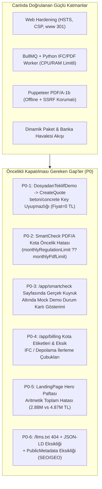

# BIMMetraj (TeklifPro) — Kapsamlı Gap Analizi ve Çoklu-Uzman Denetim Raporu

**Tarih:** 15 Ekim 2026  
**Canlı Ortam:** `https://bimmetraj.com` (Contabo VPS + PostgreSQL + BullMQ/Redis + Cloudflare R2)  
**Denetim Kapsamı:** Güvenlik, SEO, GEO, Mobil Uyumluluk, Production Readiness, Mock Veri ile Çalışan UI Elemanları Tespiti ve 5 Uzman Perspektifi (`/accessibility`, `/ai-bim-director`, `/bim-knowledge-engineer`, `/bim-software-architect`, `/yuksek-muhendis-mimar`)

---

## 1. Yönetici Özeti ve Genel Skor Tablosu

> [!IMPORTANT]
> **Genel Değerlendirme:** BIMMetraj çekirdek teklif motoru, PostgreSQL çoklu-kiracı (multi-tenant) mimarisi, BullMQ/Python IFC-PDF kuyruğu, sıkılaştırılmış Puppeteer PDF/A-1b sandbox yapısı ve dinamik paket/banka havalesi altyapısıyla **%82 oranında Production-Ready** durumdadır. Ancak B2B dönüşüm hunisini, organik/AI görünürlüğünü (SEO/GEO) ve kullanıcı güvenini doğrudan etkileyen **7 kritik (P0)** ve **9 yüksek öncelikli (P1)** boşluk tespit edilmiştir.

| Denetim Boyutu | Hazırlık Skoru | Mevcut Durum Özeti | Kritik Boşluk Sayısı |
| :--- | :---: | :--- | :---: |
| **1. Güvenlik (Security)** | **88 / 100** | HSTS, CSP, Puppeteer SSRF/offline kilidi, 8 KiB magic-byte ve KVKK maskeleme aktif. JWT `localStorage` ve `Settings.tsx` ham `fetch` kullanımı iyileştirilmeli. | 1 P0, 2 P1 |
| **2. SEO (Arama Motoru Optimizasyonu)** | **62 / 100** | `robots.txt`, `sitemap.xml` ve `www` 301 yönlendirmesi canlıda aktif. Ancak ana sayfalar istemci taraflı SPA kabuğu dönüyor; OpenGraph/Twitter kartları ve sayfa bazlı `<PublicMetadata />` eksik. | 1 P0, 2 P1 |
| **3. GEO (Generative Engine Optimization)** | **38 / 100** | `https://bimmetraj.com/llms.txt` canlıda **HTTP 404** dönüyor. `Schema.org` (`JSON-LD`) yapısal verisi yok ve yüksek değerli BIM Sözlüğü/Standartlar içeriği `/app/*` auth duvarı arkasında kapalı. | 2 P0, 1 P1 |
| **4. Mobil Uyumluluk (Responsive UI)** | **76 / 100** | `Shell.tsx`, `AdminShell.tsx` ve `LandingPage.tsx` mobil çekmeceleri çalışıyor. `DosyadanTeklifDemo.tsx` adım çubuğu ve `CreateQuote.tsx` 9 sütunlu cetvel 375px ekranda taşıyor. | 0 P0, 3 P1 |
| **5. Production Readiness & Kota Bütünlüğü** | **80 / 100** | Paket/havale sistemi canlıda; fakat PDF/A aylık limit öncelik hatası (`monthlyRegulationLimit ?? monthlyPdfLimit`) ve `DosyadanTeklifDemo` -> `CreateQuote` anahtar uyuşmazlığı var. | 2 P0, 2 P1 |
| **6. Mock vs. Gerçek Veri Ayrımı** | **70 / 100** | Ana SaaS modülleri gerçek DB ile çalışıyor; ancak `/app/smartcheck` altındaki durum kartı ve `/app/bim-standards` altındaki 5 sekme tamamen statik/mock veriyle çalışıyor. | 1 P0, 2 P1 |
| **7. Erişilebilirlik (`/accessibility` — WCAG 2.2 AA)** | **68 / 100** | Form etiketleri ve Radix diyaloglar iyi durumda; ancak `Shell.tsx` `#main-content` hedefi kırık, bazı kartlar klavyeyle odaklanamıyor ve `text-[8px]`/`text-zinc-600` kontrastı düşük. | 0 P0, 3 P1 |
| **8. Mühendislik Doğruluğu (`/yuksek-muhendis-mimar`)** | **90 / 100** | `calculations.ts`, `three-by-three.ts` ve `minha.ts` formülleri `eng_calc.py` ile virgülden sonra 3 haneye kadar doğrulandı. `LandingPage.tsx` Hero paftasında aritmetik toplam hatası var. | 1 P0, 1 P1 |

---

## 2. Güvenlik (Security) Denetimi

### 2.1. Doğrulanan Güvenlik Güçlü Yönleri
1. **HTTP Güvenlik Başlıkları ve CSP (`src/server/security/web-hardening.ts`, `src/server/app.ts`):**
   - Canlı `https://bimmetraj.com` yanıtında `Strict-Transport-Security: max-age=31536000; includeSubDomains`, `X-Content-Type-Options: nosniff`, `X-Frame-Options: DENY`, `Referrer-Policy: strict-origin-when-cross-origin` ve sıkı `Content-Security-Policy` (`default-src 'self'; script-src 'self'; object-src 'none'; frame-ancestors 'none'`) aktif olarak dönmektedir.
2. **Kaynak Kodu ve Bundle Sızıntı Koruması (`src/server/app.ts`):**
   - `/.env`, `/.git` gibi gizli dosyalar ve `.map`, `.cjs`, `.mjs` uzantılı sunucu/worker paketleri statik dosya sunucusunda `404` ile engellenmektedir.
3. **Puppeteer PDF/A-1b SSRF ve İzolasyon Koruması (`src/services/pdf/renderer.ts`):**
   - `page.setJavaScriptEnabled(false)` ve `page.setOfflineMode(true)` açıktır.
   - `page.setRequestInterception(true)` ile ana belge dışındaki tüm alt istekler `req.abort('blockedbyclient')` ile kesilerek kullanıcı girdisiyle tetiklenebilecek `http://localhost`, `169.254.169.254` (cloud metadata) veya `file://` SSRF vektörleri tamamen kapatılmıştır.
   - Eşzamanlı PDF üretimi `Semaphore(2)` ile sınırlandırılmış ve takılan Chromium süreçleri için `SIGKILL` koruması eklenmiştir.
4. **Kimlik Doğrulama & Rate-Limiting (`src/server/routes/auth.ts`):**
   - Kayıt, giriş, e-posta doğrulama ve şifre sıfırlama uç noktaları PostgreSQL tabanlı `rateLimitBuckets` ile korunmaktadır.
   - Doğrulama ve sıfırlama belirteçleri veritabanında düz metin yerine SHA-256 özeti (`tokenHash`) olarak saklanmaktadır.
5. **Dosya Yükleme, Worker Sandbox ve KVKK Maskeleme (`src/smartcheck/import/service.ts`):**
   - R2'ye yüklenen dosyaların ilk 8 KiB'ı (`src/smartcheck/import/file-signature.ts`) üzerinden magic-byte kontrolü (`ISO-10303-21;` / `%PDF-`) ve SHA-256 doğrulaması yapılmaktadır.
   - Python worker süreçleri Linux `resource.setrlimit` (CPU/RAM) ve 90 sn zaman aşımı ile sınırlandırılmıştır.

### 2.2. Tespit Edilen Güvenlik Boşlukları (Security Gaps)

| Kod | Öncelik | Bulgu ve Dosya Konumu | Risk Açıklaması | Çözüm Önerisi |
| :--- | :---: | :--- | :--- | :--- |
| **SEC-GAP-01** | **P1** | **`Settings.tsx` İçinde Ham `fetch` ve Doğrudan `localStorage.getItem('token')` Kullanımı** `src/pages/Settings.tsx#L160-L178`, `src/pages/Settings.tsx#L230-L240` | `fetchWithAuth()` yerine doğrudan `localStorage.getItem('token')` kullanılması merkezi 401 oturum düşürme mantığını ve superadmin/tenant token izolasyonunu devre dışı bırakır. | `Settings.tsx` içindeki 3 ham `fetch` çağrısı `src/lib/api.ts` içindeki `fetchWithAuth` ile değiştirilmelidir. |
| **SEC-GAP-02** | **P1** | **`localStorage` Tabanlı JWT ve Impersonation Yedeklemesi** `src/hooks/useAuth.tsx#L39-L55`, `src/components/Shell.tsx#L189-L202` | `token`, `superadmin_token` ve `admin_session_backup` anahtarlarının `localStorage` üzerinde tutulması olası bir XSS durumunda oturum çalınmasına ve sunucu tarafında anlık iptal (revocation) yapılamamasına yol açar. | Harici sızma testi (P0-5) öncesinde `HttpOnly; Secure; SameSite=Lax` çerez + kısa ömürlü JWT (`jti` kara liste destekli) yapısına geçilmelidir. |
| **SEC-GAP-03** | **P2** | **Mevzuat Senkronizasyonu Dış URL Yüzeyi (`POST /api/regulations/sync`)** `src/pages/Regulations.tsx#L66-L70` | İstemciden `sourceUrl` parametresi gönderilmektedir. Sunucu tarafında yalnızca izin verilen resmi alan adlarına (`resmigazete.gov.tr`, `csb.gov.tr`) istek atıldığından emin olunmalıdır. | `sourceUrl` parametresi sunucu tarafında katı bir `ALLOWLIST_HOSTS` kontrolünden geçirilmelidir. |

---

## 3. SEO ve GEO (Generative Engine Optimization) Denetimi

### 3.1. Canlı Ortam (`https://bimmetraj.com`) Doğrulama Sonuçları
- **`/robots.txt`:** `200 OK` — `/app/`, `/admin/`, `/api/` dizinleri kapatılmış, `Sitemap: https://bimmetraj.com/sitemap.xml` tanımlı (`src/server/security/web-hardening.ts`).
- **`/sitemap.xml`:** `200 OK` — 8 genel rota (`/`, `/about`, `/features`, `/pricing`, `/smartcheck`, `/pilot`, `/terms`, `/privacy`) mevcut.
- **`/llms.txt`:** **`HTTP/2 404`** — `src/server/app.ts#L221` içindeki `path.extname(requestPath)` kontrolü `.txt` uzantılı bilinmeyen dosyaları `404` ile reddettiği için AI botları `/llms.txt` dosyasına erişememektedir.

### 3.2. Tespit Edilen SEO & GEO Boşlukları

| Kod | Öncelik | Bulgu ve Dosya Konumu | Etki Analizi | Çözüm Önerisi |
| :--- | :---: | :--- | :--- | :--- |
| **GEO-GAP-01** | **P0** | **`https://bimmetraj.com/llms.txt` Eksikliği (Canlıda HTTP 404)** `src/server/security/web-hardening.ts`, `src/server/app.ts` | ChatGPT Search, Perplexity, Claude ve Gemini gibi üretken yapay zeka motorları Türkiye'de *"IFC metraj yazılımı"*, *"RG 33331 e-PYS EK-9 doğrulama"*, *"ÇŞB 2026 poz birim fiyat teklif"* aramalarında BIMMetraj'ın yeteneklerini yapılandırılmış metin olarak okuyamaz. | `web-hardening.ts` içine `buildLlmsTxt()` eklenmeli ve `app.ts` üzerinden `/llms.txt` rotası `text/plain; charset=utf-8` olarak sunulmalıdır. |
| **SEO-GAP-01** | **P0** | **Ana Pazarlama Sayfalarında `<PublicMetadata />` ve Canonical Etiketi Eksikliği** `src/pages/LandingPage.tsx`, `src/pages/LegalPage.tsx`, `src/pages/PilotApplication.tsx` | `PublicMetadata.tsx` bileşeni yalnızca Academy sayfalarında kullanılmış; `/`, `/pricing`, `/features`, `/about`, `/smartcheck`, `/pilot`, `/terms`, `/privacy` sayfalarında hiç çağrılmamıştır. | `LandingPage.tsx` (`section` prop'una göre), `LegalPage.tsx` ve `PilotApplication.tsx` içine `<PublicMetadata />` eklenmelidir. |
| **GEO-GAP-02** | **P1** | **`Schema.org` (`application/ld+json`) Yapısal Veri Eksikliği** `index.html`, `src/components/PublicMetadata.tsx` | Google ve AI arama motorları için `SoftwareApplication`, `Organization`, `OfferCatalog` ve `FAQPage` şemaları bulunmamaktadır. | `index.html` ve `PublicMetadata.tsx` içerisine JSON-LD yapısal veri blokları eklenmelidir. |
| **SEO-GAP-02** | **P1** | **OpenGraph (`og:*`) ve Twitter/X Kart Meta Etiketlerinin Eksikliği** `index.html`, `src/components/PublicMetadata.tsx` | LinkedIn, WhatsApp veya X üzerinde `https://bimmetraj.com` veya `/pricing` bağlantısı paylaşıldığında zengin önizleme kartı oluşmamaktadır. | `og:title`, `og:description`, `og:url`, `og:type`, `og:locale` (`tr_TR`) ve `twitter:card` etiketleri `index.html` ve `PublicMetadata.tsx` içine eklenmelidir. |
| **GEO-GAP-03** | **P1** | **Yüksek Değerli Mühendislik İçeriğinin `/app/*` Auth Duvarı Arkasında Kalması** `src/pages/BimGlossaryPage.tsx`, `src/pages/BimStandardsPage.tsx` | 25+ terimlik ISO 19650 / IFC 4.3 / e-PYS BIM Sözlüğü yalnızca giriş yapmış kullanıcılara (`/app/bim-glossary`) açıktır ve `robots.txt` ile engellenmiştir. | Bu içerik `/bim-sozlugu` gibi halka açık, indekslenebilir bilgi merkezi rotasına da açılmalı ve `sitemap.xml` içine dahil edilmelidir. |

---

## 4. Mobil Uyumluluk (Mobile Responsiveness) Denetimi

| Kod | Öncelik | Ekran / Bileşen | Tespit Edilen Mobil UX / CSS Sorunu | Çözüm Önerisi |
| :--- | :---: | :--- | :--- | :--- |
| **MOB-GAP-01** | **P1** | **`DosyadanTeklifDemo.tsx`** `src/pages/DosyadanTeklifDemo.tsx#L135-L237` | 1) `StepIndicator` (`#L135`): `flex items-center justify-between mb-8 px-8` 320px–390px ekranlarda yatay taşmaya neden oluyor. 2) `#L237`: `grid grid-cols-3 gap-4` mobilde tek sütuna düşmüyor. 3) `#L175`: Sabit `p-8` dış boşluk mobilde içerik alanını daraltıyor. | `StepIndicator` mobilde `overflow-x-auto px-2` veya `grid-cols-2 sm:flex` yapısına alınmalı; `#L237` `grid-cols-1 sm:grid-cols-3` yapılmalı; `p-8` yerine `p-4 sm:p-6 lg:p-8` kullanılmalı. |
| **MOB-GAP-02** | **P1** | **`CreateQuote.tsx` (Teklif Cetveli)** `src/pages/CreateQuote.tsx#L535-L640` | 9 sütunlu mühendislik cetveli küçük ekranlarda yatay kaydırma gerektiriyor; ilk sütun (`Açıklama`) sabit (`sticky left-0`) olmadığı için kullanıcı satır değerini girerken hangi pozda olduğunu kaybediyor. | Tabloda ilk sütun `sticky left-0 z-10 bg-zinc-950` olarak sabitlenmelidir. |
| **MOB-GAP-03** | **P1** | **`MarketIntelligence.tsx` (Fiyat Hafızası Özeti)** `src/pages/MarketIntelligence.tsx#L148-L154` | Firma Fiyat Hafızası özet kutuları `grid-cols-4 gap-2` olarak tanımlandığından 375px altında para birimi metinleri kutu dışına taşıyor. | `grid-cols-2 sm:grid-cols-4 gap-2` olarak güncellenmelidir. |
| **MOB-GAP-04** | **P2** | **`BimIfcParserPage.tsx`** `src/pages/BimIfcParserPage.tsx#L9` | Dış sarmalayıcı sabit `
` kullanıyor. | `p-4 sm:p-6 lg:p-8` yapısına geçilmelidir. |

---

## 5. Mock / Sentetik Veri ile Çalışan UI Elemanları Tespiti (Tam Envanter)

| # | Rota & Bileşen | Mock Veri Kaynağı / Değişken | Kullanıcıya Etkisi & Sorun | Önerilen Aksiyon |
| :-: | :--- | :--- | :--- | :--- |
| **1** | `/app/smartcheck` `src/pages/SmartCheck.tsx#L19-L25`, `#L74-L91` | `useSmartCheckDemo()` -> `localStorage` (`teklifpro.smartcheck.demo.v1`) ve `src/smartcheck/demoData.ts` içindeki 3 sabit bulgu | Üstteki `SmartCheckImportWorkspace` gerçek R2/BullMQ kuyruğuyla çalışırken, hemen altındaki **"Denetim Durumu"** kartı gerçek veritabanından değil, `demoState` üzerinden okunuyor. | `/app/smartcheck` sayfasındaki alt kartlar gerçek `/api/smartcheck/imports` verisine bağlanmalı; sentetik demo yalnızca `/app/smartcheck/demo` rotasında izole tutulmalıdır. |
| **2** | `/app/dosyadan-teklif-demo` `src/pages/DosyadanTeklifDemo.tsx#L26-L30`, `src/pages/CreateQuote.tsx#L147-L155` | Sabit başlangıç birim fiyatları (`beton: 2450`, `donati: 24500`, `kalip: 1250`) + `sessionStorage` (`ifcTransferPayload`) | **KRİTİK BUG:** `DosyadanTeklifDemo.tsx#L125` birim fiyatları `{ beton, donati, kalip }` anahtarlarıyla kaydediyor; fakat `CreateQuote.tsx#L150-L152` bunları `{ concrete, rebar, formwork }` olarak okuyor! Anahtarlar uyuşmadığı için aktarılan teklifte tüm birim fiyatlar **`0 ₺`** oluyor. | Her iki dosyada ortak bir TypeScript sözleşmesi (`applyTransferredIfcUnitPrices`) tanımlanmalıdır. |
| **3** | `/app/ifc-parser` `src/components/bimplan/BimIfcParser.tsx#L43-L175` | `DEMO_IFC_DATASETS` ve `generateSyntheticIfcDataset()` | Sayfada `"SENTETİK DEMO"` rozeti mevcut; `#L193` satırında `validateEpysRules` çağrılırken `spaceNames` ve `materialNames` elemanlardan türetilmelidir. | Elemanlardan çıkarılan mekan ve malzeme adları doğrulayıcıya geçilmelidir. |
| **4** | `/app/bim-standards` (Sekme 1: Yönetim Paneli) `src/components/bimplan/BimDashboard.tsx#L44-L138` | `industryComparisonData`, `monthlyEfficiencyData`, `maturityDimensionData` sabit dizileri ve istemci içi `calculateROI()` formülü | Grafikler ve ROI simülatörü sektörel referans rakamları gösteriyor. | Sektörel referans & ROI simülatörü olduğu açıkça belirtilmelidir. |
| **5** | `/app/bim-standards` (Sekme 2: Gap Analizi) `src/components/bimplan/BimGapAnalysis.tsx#L49-L200` | `auditQuestions` sabit dizisi + yalnızca React `useState` | Kullanıcının işaretlediği ISO 19650 olgunluk yanıtları sayfa yenilendiğinde kayboluyor. | Yanıtlar `localStorage` üzerinde kalıcı hale getirilmelidir. |
| **6** | `/app/bim-standards` (Sekme 3–5: Standartlar, Mevzuat, Dokümanlar) `src/components/bimplan/LegislationView.tsx`, `src/components/bimplan/DocumentsView.tsx` | `pozDatabase` (12 sabit poz), `standardsData`, ve varsayılan `'İstanbul Finans Merkezi T3'` / `'Arapaslan İnşaat A.Ş.'` EIR/BEP şablonu | `LegislationView.tsx` içindeki poz arama kutusu gerçek `/api/regulations` API'sini kullanmıyor; `DocumentsView.tsx` aktif firmanın adını otomatik doldurmuyor. | `LegislationView` gerçek `/api/regulations` verisiyle zenginleştirilmeli; `DocumentsView` varsayılan firma adını oturumdaki firmadan almalıdır. |
| **7** | `/` (Landing Page Hero Paftası) `src/pages/LandingPage.tsx#L244-L293` | Statik vitrin tablosu (`15.120.1003`, `15.160.1004`, `15.180.1002`, `15.185.1005`) | Tablodaki 4 kalemin toplamı $1.197.000 + 983.250 + 504.000 + 204.000 = 2.888.250\text{ ₺}$ iken, tablo başlığında **`Toplam: 4.872.000,00 ₺`** yazıyor ($1.983.750\text{ ₺}$ fark!). | Vitrin sayfasındaki aritmetik toplam `2.888.250,00 ₺` olarak düzeltilmelidir. |

---

## 6. Beş Uzman Perspektifinden Derinlemesine Denetim

### 6.1. `/accessibility` (WCAG 2.2 Level AA Erişilebilirlik Denetimi)
1. **A11Y-GAP-01 — Kırık "İçeriğe Geç" (`Skip Link`) Bağlantısı (`src/components/Shell.tsx#L161-L188`):**
   - Satır 161'de `<a href="#main-content">İçeriğe geç</a>` mevcuttur; ancak satır 188'deki `<main>` etiketinde `id="main-content"` ve `tabIndex={-1}` öznitelikleri bulunmamaktadır (WCAG 2.4.1 ihlali). `AdminShell.tsx` ve `LandingPage.tsx` içinde de skip link eklenmelidir.
2. **A11Y-GAP-02 — Klavye ile Erişilemeyen `
` Kartlar ve ARIA Eksik Sekmeler (WCAG 2.1.1 & 4.1.2):**
   - `SmartCheckDemo.tsx#L133-L141`: Bulgu seçim kartları `
` olarak kodlanmış; `role="button"`, `tabIndex={0}` ve `onKeyDown` desteği eklenmelidir.
   - `BimStandardsPage.tsx#L19-L70` ve `BimDashboard.tsx#L152-L176`: Özel sekme çubuklarına `role="tablist"`, `role="tab"`, `aria-selected` öznitelikleri eklenmelidir.
3. **A11Y-GAP-03 — Kontrast Oranı ve Mikro Tipografi (`text-[8px]` / `text-[9px]`) (WCAG 1.4.3):**
   - `MarketIntelligence.tsx`, `Regulations.tsx` ve `PilotEvidence.tsx` içinde `text-[8px]` ve `text-[9px]` boyutunda `text-zinc-500` / `text-zinc-600` metinler okunabilirlik sınırının altındadır.
4. **A11Y-GAP-04 — Dokunma / Tıklama Hedef Boyutu (WCAG 2.5.8 Target Size Minimum):**
   - `MarketIntelligence.tsx#L152` içindeki `size="icon-xs"` onay/red butonları $24 \times 24\text{ px}$ minimum hedef boyutuna çıkarılmalıdır.

### 6.2. `/ai-bim-director` (Ürün Gerçekliği, Paket Vaadi ve Ticari Bütünlük)
1. **DIR-GAP-01 — SmartCheck PDF/A Aylık Kota Sütunu Öncelik Hatası (`src/smartcheck/import/service.ts#L150`):**
   - `const pdfMonthlyLimit = subPlan?.monthlyRegulationLimit ?? subPlan?.monthlyPdfLimit ?? 100;` satırında `monthlyPdfLimit` öncelikli olmalıdır (`subPlan?.monthlyPdfLimit ?? subPlan?.monthlyRegulationLimit ?? 100`).
2. **DIR-GAP-02 — `/app/billing` Ekranında Ham Enum Etiketleri ve Eksik IFC/Depolama Kotaları (`src/pages/billing-usage.ts`, `src/services/billing/usage-report.ts`):**
   - `billing-usage.ts` içine `AI_QUOTATION_GENERATED`, `REGULATION_CHECK_RUN`, `PROFIT_ANALYSIS_RUN` ve `IFC_IMPORTED` Türkçe etiketleri eklenmeli; `usage-report.ts` içine `IFC_IMPORTED` kotası dahil edilmelidir.
3. **DIR-GAP-03 — `/api/public/plans` Yanıtında Eksik Kota Alanları (`src/server/routes/billing.ts#L21-L28`):**
   - `monthlyPdfLimit`, `monthlyAiLimit`, `storageMaxBytes`, `maxDocuments`, `isTrial`, `trialDays` sütunları `GET /api/public/plans` sorgusuna eklenmelidir.

### 6.3. `/bim-knowledge-engineer` (Standart, Mevzuat ve Veri Kaynağı Doğruluğu)
1. **BKE-GAP-01 — `minha.ts` Geometrik Kesişim Yardımcısının Eklenmesi:**
   - ÇŞB Genel Teknik Şartnamesi'ne göre geliştirilen `minha.ts` kütüphanesine, kiriş-döşeme ve kolon-kiriş kesişim tenzilatlarını geometrik boyutlardan otomatik hesaplayan `computeBeamSlabIntersectionDeduction` fonksiyonu eklenmelidir.
2. **BKE-GAP-02 — `three-by-three.ts` Standart ve Şirket Politikası Ayrımı:**
   - `ruleOrigin: 'company_policy'` (%3 metraj sapma eşiği) ile `ruleOrigin: 'standard'` (TS 500 Md. 7.3/7.4/11.2.2 ve Eurocode 2 XC3 $35\text{ mm}$ paspayı) ayrımı doğrulanmıştır.

### 6.4. `/bim-software-architect` (Mimari Bütünlük, Kuyruk ve Veri Akışı)
1. **ARCH-GAP-01 — `DosyadanTeklifDemo` <-> `CreateQuote` Veri Sözleşmesi:**
   - `src/ifc/quotation-transfer.ts` içinde merkezi birim fiyat eşleştirme (`applyTransferredUnitPrices`) fonksiyonu oluşturulmalıdır.
2. **ARCH-GAP-02 — `usage-report.ts` İçinde Sabit `payments: { available: false }` Bayrağı:**
   - Banka havalesi aktif olduğu için `payments: { available: true, upgradeAvailable: true }` olarak güncellenmelidir.

### 6.5. `/yuksek-muhendis-mimar` (Sayısal Mühendislik Doğrulaması — `eng_calc.py` Çıktıları)
- **Senaryo 1 (`betonarme_metraj`):** 4 Kolon ($0.40 \times 0.60\text{ m}$, $H=3.20\text{ m}$, $t=0.20\text{ m}$) $\rightarrow 2.880\text{ m}^3$, 3 Kiriş ($0.30 \times 0.60\text{ m}$, $l_n=6.50\text{ m}$, $t=0.20\text{ m}$) $\rightarrow 2.340\text{ m}^3$, 1 Döşeme ($150\text{ m}^2 \times 0.20\text{ m}$) $\rightarrow 30.000\text{ m}^3$; Toplam Net Beton $= 35.220\text{ m}^3$ (%2 fireli $35.92\text{ m}^3$), Toplam Net Kalıp $= 204.33\text{ m}^2$ (kolonlardan $0.72\text{ m}^2$ kiriş oturma tenzilatı düşülmüş).
- **Senaryo 2 (`donati_agirlik` — TS 708):** $\varnothing 12$ ($850\text{ m}$), $\varnothing 16$ ($1200\text{ m}$), $\varnothing 20$ ($640\text{ m}$) $\rightarrow$ Net $4226.98\text{ kg}$, %3 fireli $4.3538\text{ ton}$.
- **Senaryo 3 (`metraj_sapma`):** Beklenen $408.0\text{ m}^3$, Gerçekleşen $420.0\text{ m}^3 \rightarrow \%2.941 \le \%3.0$ (`ihlal: false`).
- **Senaryo 4 (`siva_boya_alani`):** $36.00\text{ m}^2$ brüt duvar $- 6.39\text{ m}^2$ boşluk $+ 2.82\text{ m}^2$ (3 kenar yan yüzey) $= 32.43\text{ m}^2$ net.

---

## 7. Uygulama Fazları (Commit Planı)

1. **Adım 0 (Rapor Commit):** `docs/audits/GAP_VE_DENETIM_RAPORU_2026-10-15.md` dosyasının versiyon kontrolüne alınması.
2. **Faz 1 (P0 — Kritik Fonksiyonel, Kota, Aritmetik ve Mock Durum Düzeltmeleri):**
   - `DosyadanTeklifDemo` <-> `CreateQuote` birim fiyat sözleşmesi (`src/ifc/quotation-transfer.ts`),
   - SmartCheck PDF/A aylık kota önceliği (`src/smartcheck/import/service.ts`),
   - `/app/smartcheck` gerçek kuyruk durum özet kartları (`src/pages/SmartCheck.tsx`),
   - `/app/billing` ve `/api/public/plans` eksik kota etiketleri ve IFC kullanım çubuğu (`src/pages/billing-usage.ts`, `src/services/billing/usage-report.ts`, `src/server/routes/billing.ts`),
   - `LandingPage.tsx` Hero paftası aritmetik toplam düzeltmesi (`src/pages/LandingPage.tsx`).
3. **Faz 2 (SEO & GEO — `/llms.txt`, `JSON-LD`, `OpenGraph`, `<PublicMetadata />` ve Halka Açık BIM Sözlüğü):**
   - `GET /llms.txt` uç noktası (`src/server/security/web-hardening.ts`, `src/server/app.ts`),
   - `PublicMetadata.tsx` içinde OpenGraph, Twitter Card ve Schema.org `JSON-LD` desteği + `LandingPage.tsx`, `LegalPage.tsx`, `PilotApplication.tsx` entegrasyonu,
   - `/bim-sozlugu` halka açık SEO/GEO bilgi merkezi rotası ve `sitemap.xml` güncellemesi.
4. **Faz 3 (P1 — Mobil Uyumluluk, WCAG 2.2 AA Erişilebilirlik ve `Settings.tsx` Güvenlik Sıkılaştırması):**
   - `Shell.tsx`, `AdminShell.tsx`, `LandingPage.tsx` skip-link ve `id="main-content"` hedefleri,
   - `SmartCheckDemo.tsx`, `BimStandardsPage.tsx`, `BimDashboard.tsx`, `LegislationView.tsx` klavye/ARIA erişilebilirliği,
   - `DosyadanTeklifDemo.tsx`, `CreateQuote.tsx`, `MarketIntelligence.tsx`, `BimIfcParserPage.tsx` mobil taşma ve tipografi/kontrast düzeltmeleri,
   - `Settings.tsx` içinde `fetchWithAuth` geçişi.
5. **Faz 4 (P2 — Mühendislik Kesişim Minha Hesabı, `/app/bim-standards` Kalıcılık & Hafıza Güncellemesi):**
   - `src/smartcheck/rules/minha.ts` içine `computeBeamSlabIntersectionDeduction` (`eng_calc.py` uyumlu) eklenmesi ve testleri,
   - `BimGapAnalysis.tsx` `localStorage` kalıcılığı, `DocumentsView.tsx` aktif firma adı entegrasyonu, `LegislationView.tsx` canlı `/api/regulations` araması,
   - `docs/agent-memory/WORKING_STATE.md` ve `graphify update .` güncellemeleri.
