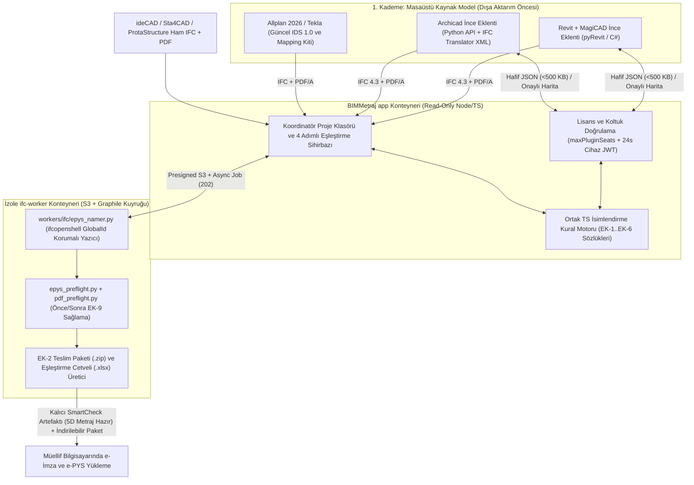

# PRD: BIMMetraj e-PYS Otomatik İsimlendirme, Dönüştürme ve Çift Kademeli Teknik Sağlama Sistemi

- **Doküman Sürümü:** `1.0.0`
- **Tarih:** 1 Kasım 2026
- **Durum:** Müellif / Ürün Sahibi Onayına Sunuldu *(Proje kodlarında değişiklik yapılmamıştır)*
- **Seçilen Mimari:** **Yaklaşım A** — Merkezi Bulut Kural & Dönüşüm Çekirdeği + İnce Masaüstü Eklentileri (Revit & Archicad) + Web `ifcopenshell` Dönüştürücü & EK-9 Sağlama Kapısı
- **Çoklu Disiplin & İşbirliği Modeli:** **Koordinatör Abone Klasörü** (`company_id FORCE RLS` uyumlu `1:N` proje-disiplin şeması; gelecekte üyeliksiz misafir müellif onay linkine genişlemeye hazır)
- **Birincil Mevzuat Dayanağı (05.08.2026 / Resmî Gazete Sayı: 33331):**
  - [#1.pdf](file:///Users/hazarvolgaekiz/dev/products/bimplanacademy/TeklifPro-repo/o%CC%88rnek-exceller/e-pys%20Yo%CC%88netmelik%202026-10-12/%231.pdf) — *Mimarlık ve Mühendislik Projelerinin Dijital Olarak Hazırlanması Hakkında Yönetmelik* (m.1–17, Geçici m.1–2)
  - [#2.pdf](file:///Users/hazarvolgaekiz/dev/products/bimplanacademy/TeklifPro-repo/o%CC%88rnek-exceller/e-pys%20Yo%CC%88netmelik%202026-10-12/%232.pdf) — *Mimarlık ve Mühendislik Projelerinin Elektronik Ortamda Teslimi ve Yönetilmesi Hakkında Yönetmelik* (m.1–9)
  - [EKLER.pdf](file:///Users/hazarvolgaekiz/dev/products/bimplanacademy/TeklifPro-repo/o%CC%88rnek-exceller/e-pys%20Yo%CC%88netmelik%202026-10-12/EKLER.pdf) — Resmi Ekler (`EK-1` .. `EK-9`, 241 sayfa)

> [!IMPORTANT]
> **Hukuki ve Düzenleyici Konumlandırma (`#2.pdf` m.5(2)):** Yönetmelik uyarınca e-PYS'ye yüklenen dosyalardaki bilgilerin doğruluğundan proje müellifi sorumludur ve resmi kabul/ret yetkisi ilgili idareye aittir. Bu ürün **"resmi onay garantisi"** vaat etmez; müellif hatalarını ve yazılım kısıtlarını ortadan kaldıran **"Kaynakta Standart Kodlama + Web'de Bağımsız EK-9 Teknik Sağlaması"** hizmeti sunar.

---

## 1. Amaç, Saha Problemi ve Stratejik Vizyon

### 1.1 Sahadaki Gerçek Sorun (Repo Kanıtlarıyla)
RG 33331 kapsamındaki dijital yapı ruhsatı başvurularında Bakanlık; dış dosya adlarından (`EK-1`, `EK-2`), model içindeki yapı elemanlarına (`EK-5`), mahallere (`EK-3`) ve malzemelere (`EK-6`) kadar **dört katmanlı bir ulusal isimlendirme standardı** zorunlu tutmaktadır.

Repodaki gerçek saha dosyaları, bu kuralların BIM/statik yazılımlarında elle uygulanmasının ciddi bir darboğaz olduğunu göstermektedir:
1. **Revit ve Archicad Dışa Aktarım Darboğazı ([ssss.ifc](file:///Users/hazarvolgaekiz/dev/products/bimplanacademy/TeklifPro-repo/o%CC%88rnek-exceller/ssss.ifc)):**
   - Revit'in yerleşik IFC dışa aktarıcısı (`ODA SDAI`), her elemanda `IfcName` parametresi doldurulmadıkça `Name` alanını sabit tip adıyla (`'Tuğla Taşıyıcı'`, `'Kapı'`) veya boş (`' '`) basmaktadır.
   - Aynı modelde mahaller (`IfcSpace`) `'Oda No'` / `'Y. ODASI'` olarak, malzemeler (`IfcMaterial`) ise dayanım sınıfı olmadan (`'Beton Donatılı'`, `'Tuğla'`, `'Sıva'`, `'Fayans'`) çıkmaktadır.
   - Archicad tarafında da 69 zorunlu + 67 isteğe bağlı `EK-5` sınıf kodunu ifade (expression) formülleriyle kurgulamak ofisler için yüksek hata üretmektedir.
2. **Şablonlu Yazılımlarda Dahi Sürüm ve İnsan Hataları ([2026_45_MM_XXXX_MD_MMC_NNN_01_duzenlenmis.zip](file:///Users/hazarvolgaekiz/dev/products/bimplanacademy/TeklifPro-repo/o%CC%88rnek-exceller/2026_45_MM_XXXX_MD_MMC_NNN_01_duzenlenmis.zip)):**
   - Allplan ortamında hazırlanmış örnek modelde bile Kasım 2025 taslağı ile Ağustos 2026 nihai Resmi Gazete metni arasındaki farklar nedeniyle `IfcSlab` adları `ST_TML_BETON-C35` (ters ayraç), `IfcSpace` numaraları `BDR_BDR_011` (`B01` yerine `BDR`) ve şema `IFC4` olarak kalmıştır.
3. **2B PDF/A – 3B IFC Tutarlılık Zorunluluğu ([#1.pdf](file:///Users/hazarvolgaekiz/dev/products/bimplanacademy/TeklifPro-repo/o%CC%88rnek-exceller/e-pys%20Yo%CC%88netmelik%202026-10-12/%231.pdf) m.9(1)):**
   - BIM modelinden üretilen 2B PDF/A paftalar ile 3B IFC modelinin birbiriyle birebir uyumlu olması zorunludur. Yalnızca dışa aktarılmış `.ifc` dosyasındaki mahal numaralarını (`K00_SLN_001`) değiştirmek, Revit/Archicad'den basılan 2B kat planı PDF/A paftalarında eski oda numaraları (`101` vb.) kalırsa mevzuat uyumsuzluğu yaratır.

### 1.2 Ürün Vizyonu: Çift Kademeli Teknik Güvence
1. **1. Kademe — Kaynakta Standart Kodlama (Lisanslı Masaüstü Eklentileri & Şablon Kitleri):** Revit (+ MagiCAD) ve Archicad içindeki ince eklentiler, BIMMetraj Bulut API'sine bağlanarak kaynak modeldeki (`.rvt` / `.pln`) eleman, mahal ve malzeme verilerini **2B PDF/A ve 3B IFC dışa aktarımı öncesinde** kodlar. Böylece pafta ve model aynı kaynaktan tutarlı çıkar.
2. **2. Kademe — Web Dönüştürücü, Paketleyici ve Bağımsız EK-9 Sağlama Kapısı:** Kapalı kutu yerli yazılımlardan (`ideCAD`, `Sta4CAD`, `ProtaStructure`) veya şablonsuz projelerden gelen `.ifc` ve `.pdf` dosyalarını web'de `ifcopenshell` ile dönüştürür; masaüstü eklentiden gelen dosyalar için ise dışa aktarıcının otomatik ürettiği seçilemez alt varlıkları (`IfcOpeningElement` vb.) temizleyip **Önce/Sonra EK-9 Sağlama Raporu** ve e-imzaya hazır `.zip` teslim paketi üretir.

---

## 2. Türkiye e-PYS Yazılım Ekosistemi Analizi ve Kapsama Matrisi

Türkiye yapı ruhsatı pazarındaki yazılımlar **API açıklığı** ve **yerleşik IFC eşleme yeteneğine** göre üç grupta kapsanır:

| Grup | Yazılımlar | Disiplinler | Açık Plugin SDK / API Durumu | BIMMetraj Kapsama Yöntemi |
| :--- | :--- | :--- | :--- | :--- |
| **Grup 1: Masaüstü Eklenti Geliştirilecekler** | **Autodesk Revit (+ MagiCAD)**, **Graphisoft Archicad** | `MM`, `IM`, `ST`, `MK`, `EE`, `YN` | **Açık API var** (Revit `.NET` / `pyRevit`; Archicad `Python/JSON`). MagiCAD Revit üzerinde çalıştığı için tek Revit eklentisi MagiCAD MEP elemanlarını da kapsar. | **Lisanslı İnce Masaüstü Eklentisi + Web Sağlama Kapısı** |
| **Grup 2: Hazır Şablon Kiti Verilecekler** | **Nemetschek Allplan**, **Tekla Structures** | `MM`, `ST` (Betonarme / Çelik) | Allplan 2026 yerleşik Formül Özniteliği + `.cfg` + tam `IDS 1.0` desteğine; Tekla ise güçlü `IFC Property Mapping` motoruna sahip. | **Güncel İndirilebilir Şablon Kiti ([epys-allplan-kit.ts](file:///Users/hazarvolgaekiz/dev/products/bimplanacademy/TeklifPro-repo/src/smartcheck/epys-allplan-kit.ts)) + Web Dönüştürücü** |
| **Grup 3: Kapalı Kutular & Web Dönüştürücü ile Yakalanacaklar** | **ideCAD (Statik/Mimari)**, **Sta4CAD**, **ProtaStructure**, **DDS-CAD**, **ZetaCAD/MTH**, **Netcad**, **Civil 3D**, **BricsCAD BIM**, **Vectorworks** | `ST`, `MM`, `MK`, `EE`, `HR`, `AL` | **ideCAD ve Sta4CAD'in üçüncü parti eklenti SDK'sı yoktur** (kapalı kutu). Üstelik `ST`, `MK`, `EE` modellerinde `EK-9 Tablo 9.2` gereği `IfcSpace` zorunluluğu da bulunmaz. | **BIMMetraj Web `ifcopenshell` Dönüştürücü & Paketleyici** *(2B paftayla çelişki yaratmadan tam `.ifc` onarımı)* |

> [!TIP]
> **Allplan Kararı Özeti:** Allplan 2026'da `ATT_ID:XXX->IfcProduct:Name(IfcLabel)` `.cfg` haritalaması, dinamik formül öznitelikleri ve tam `IDS 1.0` (*automatic Attribute Set adoption*) yerleşik geldiği ve Türkiye'de Aluplan şablonları kullanıldığı için Allplan'a derlenmiş C++ eklentisi yazılmayacaktır. Mevcut [epys-allplan-kit.ts](file:///Users/hazarvolgaekiz/dev/products/bimplanacademy/TeklifPro-repo/src/smartcheck/epys-allplan-kit.ts) nihai RG 33331 kurallarına güncellenecek; eski/hatalı Allplan `.ifc` çıktıları Web Dönüştürücü ile onarılacaktır.

---

## 3. Hedefler, Kapsam Dışı ve Anti-Hedefler

### 3.1 Hedefler (Goals)
1. **Dört Katmanlı e-PYS İsimlendirme Otomasyonu:**
   - **Katman 1 (`m.6`, `EK-1`, `EK-2`):** 9 parçalı `.ifc` ve `.pdf` dosya adı üretimi + `IfcProject.Name` senkronizasyonu.
   - **Katman 2 (`m.11`, `EK-5 5.5`):** 69 zorunlu + 67 isteğe bağlı IFC sınıfı için `Disiplin-KategoriKodu-Aciklama` üretimi/onarımı ve iskelet varlık (`IfcSite`, `IfcBuilding`, `IfcBuildingStorey`, `IfcZone`) `Name`/`LongName` tamamlaması.
   - **Katman 3 (`m.7(2)`, `m.10(2)`, `EK-3`):** `IfcSpace.Name` (`KatKodu_BolumKodu_SiraNo`) ve `IfcSpace.LongName` (`EK-3 Tablo 3.2`) standardizasyonu.
   - **Katman 4 (`m.12(2)`, `EK-6`):** `IfcMaterial.Name` (katmanlı malzemeler dahil) `Malzeme İsmi_Dayanım/Nitelik` standardizasyonu.
2. **Gruplanmış Müellif Onay Akışı (`Öner → Müellif Onayla → Uygula`):** Binlerce elemanı tek tek düzenletmek yerine benzersiz grup satırları üzerinden 1–2 dakikada eksikleri tamamlatmak ve değiştirilemez onay kaydı (`Audit Log`) tutmak.
3. **Koordinatör Abone Klasörü:** Tek bir abone çalışma alanında (`company_id`) bir `ProjeKodu` altında Mimari, Statik, Mekanik ve Elektrik disiplin dosyalarını ortak kat/proje kodu kilidiyle toplayıp e-imzaya hazır teslim paketi üretmek.
4. **5D Metraj Köprüsü:** Web'de dönüştürülen `.ifc` modelini tekrar yüklemeye gerek kalmadan tek tıkla 5D Metraj ([BimIfcParser.tsx](file:///Users/hazarvolgaekiz/dev/products/bimplanacademy/TeklifPro-repo/src/components/bimplan/BimIfcParser.tsx)) akışına aktarmak.

### 3.2 Kapsam Dışı (Non-Goals)
- Allplan için C++ derlenmiş masaüstü eklentisi geliştirmek.
- Eksik 3B BIM geometrisi çizmek veya `IFC2X3` / `IFC4` dosyalarının geometrik şemasını otomatik `IFC4X3_ADD2` şemasına yükseltmek *(Web dönüştürücü mevcut şemayı koruyarak isim/öznitelik onarımı yapar ve şema `IFC4X3` değilse kaynak yazılımdan `IFC 4.3` dışa aktarım uyarısı üretir)*.
- BIMMetraj sunucusunda müellifin USB e-imza donanımıyla (NES) bulutta imzalama yapmak *(e-imza müellifin kendi bilgisayarında indirilen hazır paket üzerine atılır)*.
- `EK-4` 2B yerel `.dwg`/`.dxf` CAD katman isimlendirmesi *(nihai yönetmelikte `.dxf` teslimi kaldırılmıştır)*.
- PDF/A olmayan ham PDF dosyalarını bu modül içinde Ghostscript ile PDF/A formatına dönüştürmek *(ayrı L1 yol haritası kalemidir)*.
- Modelde hiç malzeme atanmamış elemanlara (`IfcRelAssociatesMaterial` eksikliği) veya eksik yangın/akustik Pset'lerine otomatik mühendislik değeri atamak *(bunlar EK-9 raporunda şeffaf bulgu olarak raporlanmaya devam eder)*.

### 3.3 Anti-Hedefler (Anti-Goals — Kesin Yasaklar)
- **Uydurma Mühendislik Verisi:** Modelde `'Beton Donatılı'` yazıyorsa müellif açıkça seçmeden varsayılan `C25` veya `C30` atamak yasaktır.
- **Yasaklı Uyumluluk İddiaları:** Arayüz, rapor ve pazarlama metinlerinde `"%100 uyumlu"`, `"tam uyumlu"` veya `"idare onay garantili"` ifadeleri kullanılamaz.
- **`GlobalId` Değiştirmek:** IFC dönüşümü sırasında hiçbir varlığın 22 karakterlik `GlobalId` değeri değiştirilemez.
- **İmzalı PDF/A İçeriğine Dokunmak:** Üzerinde elektronik imza (`/Sig`) bulunan PDF'lerin iç byte'ları değiştirilemez (yalnızca dış dosya adı EK-2 şablonuna göre yeniden adlandırılabilir).
- **Sessiz 2B–3B Mahal Uyumsuzluğu:** Web'de `.ifc` içindeki `IfcSpace.Name` (mahal numarası) değiştirildiğinde müellife `#1.pdf` m.9(1) 2B PDF/A kat planı tutarlılık uyarısı ve eşleştirme cetveli verilmeden işlem kapatılamaz.

---

## 4. Kısıtlar (Constraints)

1. **Geliştirici Donanım Kısıtı (Apple MacBook / macOS):**
   - Web motoru (TypeScript + Python `ifcopenshell`) ve Archicad eklentisi (macOS doğal Archicad + Python/JSON API + `.xml` IFC Translator) doğrudan MacBook üzerinde geliştirilip test edilir.
   - Revit yalnızca Windows'ta çalıştığından Revit istemcisi ultra-ince tutulur: **Faz 3A**'da derlemesiz `pyRevit` (Python) uzantısı olarak yazılır; **Faz 3B**'de kurumsal C# `.dll` paketi GitHub Actions (`windows-latest` + `Nice3point.Revit.Api`) üzerinde bulutta derlenip Windows test makinesinde / Parallels VM'de doğrulanır.
2. **Üretim Konteyner Güvenlik Sınırı (`ADR-008`):**
   - Üretimde `app` konteyneri `read_only: true` çalışır ve Python/`ifcopenshell` içermez ([Dockerfile](file:///Users/hazarvolgaekiz/dev/products/bimplanacademy/TeklifPro-repo/Dockerfile), [compose.coolify.yaml](file:///Users/hazarvolgaekiz/dev/products/bimplanacademy/TeklifPro-repo/compose.coolify.yaml)). Tüm `.ifc`/`.pdf` dosya okuma-yazma işlemleri S3 + Graphile kuyruğu üzerinden izole `ifc-worker` konteynerinde (`2 GB RAM`, `120 sn CPU`) yürütülür.
3. **KVKK ve Kiracı İzolasyonu:**
   - Tüm veritabanı tabloları mevcut tek-`company_id` `FORCE RLS` politikasına tabidir ([schema.ts](file:///Users/hazarvolgaekiz/dev/products/bimplanacademy/TeklifPro-repo/src/db/schema.ts)).
   - Rapor ve loglarda TC/VKN/telefon/e-posta maskelemesi ([epys_preflight.py](file:///Users/hazarvolgaekiz/dev/products/bimplanacademy/TeklifPro-repo/workers/ifc/epys_preflight.py) `mask_personal_data`) zorunludur. Masaüstü eklenti çağrılarında 3B geometri buluta gönderilmez, yalnızca `< 500 KB` JSON öznitelik özeti gönderilir.

---

## 5. Değerlendirilen Yaklaşımlar ve Mimari Seçim

| Kriter | Yaklaşım A: Merkezi Bulut Beyni + İnce Eklentiler + Web Dönüştürücü *(SEÇİLEN)* | Yaklaşım B: Çevrimdışı (Offline) Kalın Masaüstü Eklentileri + Web Sağlama | Yaklaşım C: Eklentisiz Web Dönüştürücü + Tek Kullanımlık Betik İndirme |
| :--- | :--- | :--- | :--- |
| **Kural Tekilliği** | Tek merkez ([ek2_disiplinler.json](file:///Users/hazarvolgaekiz/dev/products/bimplanacademy/TeklifPro-repo/workers/ifc/vendor/ifc_ruhsat/ekler/ek2_disiplinler.json), [ek3_mahaller.json](file:///Users/hazarvolgaekiz/dev/products/bimplanacademy/TeklifPro-repo/workers/ifc/vendor/ifc_ruhsat/ekler/ek3_mahaller.json), [ek5_siniflar.json](file:///Users/hazarvolgaekiz/dev/products/bimplanacademy/TeklifPro-repo/workers/ifc/vendor/ifc_ruhsat/ekler/ek5_siniflar.json)); mevzuat güncellemesi anında tüm istemcilere yansır | Aynı kuralları TS, C# ve Python'da 3 kez ayrı ayrı yazma ve bakım yükü | Tek merkez (Web) |
| **2B PDF/A – 3B IFC Uyumu (`m.9(1)`)** | Kaynak modelde dışa aktarım öncesi yazıldığı için doğal uyum | Doğal uyum | Müellifin indirdiği betiği kaynak yazılımda elle çalıştırmasına bağlı |
| **Kapalı Yazılımlar (`ideCAD`, `Sta4CAD`)** | Web `ifcopenshell` dönüştürücü ile tam destek | Desteklemez (yalnızca hata raporu verir) | Web `ifcopenshell` dönüştürücü ile tam destek |
| **MacBook Geliştirme Uyumu** | Çok yüksek (Revit istemcisi çok ince) | Düşük (ağır C# kural motoru bakımı) | Çok yüksek |
| **Ticari Lisans Koruma** | Sunucu tarafı koltuk aktivasyonu ve kural koruması | Offline `.dll` kırılma riski yüksek | Masaüstü eklenti lisansı algısı zayıf |
| **Ödünleşim (Trade-off)** | Masaüstü eklentinin çalışması için internet bağlantısı gerekir | Yüksek bakım maliyeti ve dar yazılım kapsamı | Manuel betik çalıştırma sürtünmesi |

**Seçim:** Hem kaynak modelde (Revit/Archicad) hem teslim kapısında (Web `ideCAD`/`Sta4CAD`/Allplan) tam pazar kapsaması sağladığı, kural motorunu tek merkezde tuttuğu ve koltuk bazlı B2B abonelik değerini koruduğu için **Yaklaşım A** seçilmiştir.

---

## 6. Sistem Mimarisi ve Konteyner Topolojisi

---

## 7. Dört Katmanlı İsimlendirme Motoru — Kesin Teknik Kurallar

### 7.1 Katman 1: Proje Kodu ve Dosya Adı (`m.6`, `EK-1`, `EK-2 Tablo 2.1–2.14`)
- **Şablon:** `ProjeKodu(6)_BinaKodu(2)_Disiplin(2)_AltDisiplin(4)_DosyaTuru(2)_DosyaTipi(3)_KatKonum(3)_SiraNo(2)_RevizyonNo(3).<ifc|pdf>`
  - Örnek IFC: `260145_00_MM_GNEL_MD_BIM_000_01_000.ifc`
  - Örnek PDF/A Pafta: `260145_00_MM_GNEL_PL_MMC_K00_01_000.pdf`
- **Kurallar ([isim.py](file:///Users/hazarvolgaekiz/dev/products/bimplanacademy/TeklifPro-repo/workers/ifc/vendor/ifc_ruhsat/kurallar/isim.py) & [iso19650.ts](file:///Users/hazarvolgaekiz/dev/products/bimplanacademy/TeklifPro-repo/src/smartcheck/rules/iso19650.ts) tam uyumlu):**
  - Koordinatör klasöründe tanımlanan 6 haneli alfasayısal `ProjeKodu`, klasördeki tüm disiplin `.ifc` modellerinin `IfcProject.Name` alanına otomatik yazılır.
  - Çoklu PDF/A pafta yüklemelerinde dosya adından tür/kat ipuçları (`Zemin Kat Planı.pdf` → `PL`, `MMC`, `K00`) çıkarılır, çakışmasız `SiraNo` (`01..99`) önerilir ve müellif tablodan onaylar. İmzalı (`/Sig`) PDF'lerin iç byte'larına dokunulmadan yalnız dış dosya adı yeniden adlandırılır.

### 7.2 Katman 2: BIM Varlık İsimlendirmesi (`m.11`, `EK-5 5.5` & `Tablo 5.1–5.3`)
- **Şablon:** `Disiplin(2)-KategoriKodu(3)-Aciklama` (`^([A-Z]{2})-([A-Z]{3})(?:-([^\s-]+))?$`, örn. `MM-DVR-dis_tugla_20cm`, `ST-KLN-beton_c30_40x60`).
  - *Ayraç Kuralı:* `#1.pdf` m.11(2) ile `EKLER.pdf` EK-5 5.5 arasındaki metin farkında, [isim.py](file:///Users/hazarvolgaekiz/dev/products/bimplanacademy/TeklifPro-repo/workers/ifc/vendor/ifc_ruhsat/kurallar/isim.py) ve [KAYNAKLAR.md](file:///Users/hazarvolgaekiz/dev/products/bimplanacademy/TeklifPro-repo/workers/ifc/vendor/ifc_ruhsat/KAYNAKLAR.md) ile birebir uyumlu olarak **alanlar arası orta tire (`-`), açıklama içi alt tire (`_`)** uygulanır.
- **İskelet Sınıflar (`SABLON_DISI`):** `IfcProject`, `IfcSite`, `IfcBuilding`, `IfcBuildingStorey`, `IfcSpace`, `IfcZone`, `IfcGridAxis` bu şablona sokulmaz; bunların eksik `Name`/`LongName` öznitelikleri proje ve kat künyesinden tamamlanır.
- **Eski Şema, Liste Dışı Sınıflar ve Otomatik Alt Varlıklar:**
  - `IFC4`/`IFC2X3` alt sınıfları (`IfcWallStandardCase` → `IfcWall` / `DVR`, `IfcSlabElementedCase` → `IfcSlab` / `DSH`) üst sınıfa eşlenir; [isim.py](file:///Users/hazarvolgaekiz/dev/products/bimplanacademy/TeklifPro-repo/workers/ifc/vendor/ifc_ruhsat/kurallar/isim.py) bu üst-sınıf eşlemesini kabul edecek ve `EK-5` listesinde bulunmayan sınıflarda (`IfcPlate`, `IfcBuildingElementPart`) sert hata yerine `sinif-liste-disi` uyarısı üretecek şekilde uyumlaştırılır.
  - Kaynak yazılımda seçilemeyen ve dışa aktarıcının otomatik ürettiği `IfcOpeningElement` (`ACL`) varlıkları 2. Kademe Web geçişinde `Disiplin-ACL-bosluk_<sira>` olarak otomatik adlandırılır.
  - Aynı `(IfcClass, Name, ObjectPlacement)` üçlüsünü paylaşan çok katmanlı `IfcCovering` elemanlarında [yapi.py](file:///Users/hazarvolgaekiz/dev/products/bimplanacademy/TeklifPro-repo/workers/ifc/vendor/ifc_ruhsat/kurallar/yapi.py) `yinelenen-eleman` uyarısını önlemek için açıklama sonuna katman ayırt edicisi eklenir.

### 7.3 Katman 3: Mahal Numarası ve İsmi (`m.7(2)`, `m.10(2)`, `EK-3 Tablo 3.1–3.2`)
- **Şablon ([mahal.py](file:///Users/hazarvolgaekiz/dev/products/bimplanacademy/TeklifPro-repo/workers/ifc/vendor/ifc_ruhsat/kurallar/mahal.py)):**
  - `IfcSpace.Name`: `KatKodu(3)_BolumKodu(3)_SiraNo(3)` (`^(B\d{2}|K\d{2}|NNN)_([A-Z0-9]{3})_(\d{3})$`). ([ek3_mahaller.json](file:///Users/hazarvolgaekiz/dev/products/bimplanacademy/TeklifPro-repo/workers/ifc/vendor/ifc_ruhsat/ekler/ek3_mahaller.json) içindeki `"SÇO"` gibi kodlar numara içinde ASCII `"SCO"` olarak normalize edilir.)
  - `IfcSpace.LongName`: `EK-3 Tablo 3.2` resmi mahal adı (`Salon`, `Yatak Odası`, `Yangın Güvenlik Holü`) veya tabloda olmayan mahallerde (`Antre`, `Asansör`) `Tablo 3.2` ile çakışmayan proje-özel ad (`EK-3 3.3`).
- **Bağımsız Bölüm Korumalı Çift Mod:**
  1. Modelde zaten geçerli bir 3 haneli bağımsız bölüm/daire kodu varsa (`K00_D01_003` veya kat öneki hatalı `BDR_D01_003`), mevcut `BolumKodu` (`D01`) ve `SiraNo` (`003`) **korunur**, yalnız hatalı `KatKodu` (`BDR` → `B01`) ve `LongName` onarılır.
  2. Numarasız mahallerde (`'Oda No'`) müellif `BolumKodu` stratejisini seçer (*Bağımsız Bölüm Kodu `D01/ORT`* veya *EK-3 Fonksiyon Kodu `SLN/YTO`*); `SiraNo` her `(KatKodu, BolumKodu)` çifti içinde `001`'den başlayarak deterministik atanır.
  3. Kısaltılmış belirsiz adlar (`'Y. ODASI'`) bulanık Türkçe sözlükle aday önerir ancak statüsü `sarı (müellif onayı zorunlu)` kalır.

### 7.4 Katman 4: Malzeme İsimlendirmesi (`m.12(2)`, `EK-6 Tablo 6.1–6.68`)
- **Eski Taslak Kuralının Temizlenmesi:** Nihai `#1.pdf` Resmi Gazete metninden çıkarılmış olan *"15 karakter malzeme sınırı"*, [epys.ts](file:///Users/hazarvolgaekiz/dev/products/bimplanacademy/TeklifPro-repo/src/smartcheck/rules/epys.ts) ve [epys-allplan-kit.ts](file:///Users/hazarvolgaekiz/dev/products/bimplanacademy/TeklifPro-repo/src/smartcheck/epys-allplan-kit.ts) içinden kaldırılarak Python [ozellik.py](file:///Users/hazarvolgaekiz/dev/products/bimplanacademy/TeklifPro-repo/workers/ifc/vendor/ifc_ruhsat/kurallar/ozellik.py) ile eşitlenir.
- **Yapısal vs. İnce Yapı Malzemeleri:**
  - **Yapısal malzemeler (`Beton`, `Çelik`, `Donatı`, `Gazbeton`, `Tuğla`):** Adda dayanım varsa (`C30/37 Beton`) otomatik `Beton_C30/37` önerilir; dayanım yoksa (`'Beton Donatılı'`) müellifin dayanım sınıfı seçmesi zorunludur.
  - **Dayanım sınıfı olmayan ince yapı / kaplama malzemeleri (`Parke`, `Fayans`, `Süpürgelik`, `Sıva`, `Şap`, `Boya`, `Cam`):** Yapısal dayanım uydurmak yerine `Malzeme_Tip/Kalınlık` nitelik seçicisi (`Seramik_Kaplama`, `Siva_Ic`, `Parke_Laminat`, `Sap_5cm`) sunularak mühendislik doğruluğu ve `_` biçim kuralı birlikte karşılanır.

---

## 8. Veri Modeli, API Sözleşmesi ve Ticari Lisanslama

### 8.1 Koordinatör Abone Klasörü Şeması (`company_id FORCE RLS` Uyumlu)
Mevcut tek-kiracılı `FORCE RLS` güvenlik duvarına hiç dokunulmadan iki yeni tablo (ve denetim izi tablosu) eklenir:
1. `epys_projects`: `id`, `company_id` (`FORCE RLS`), `project_code` (6 hane, `EK-1`), `building_code` (`00`..`99`), `storey_map_json` (tüm disiplinlerin uyması gereken ortak `B01..K99` kat sözlüğü), `created_by`, `created_at`.
2. `epys_project_disciplines`: `id`, `epys_project_id`, `company_id` (`FORCE RLS`), `discipline_code` (`MM`, `ST`, `MK`, `EE`...), `source_document_id`, `converted_document_id` (SmartCheck `documents` FK — 5D Metraj hazır), `naming_session_token` (masaüstü eklenti ile web yüklemesini birleştiren tekil anahtar), `contributor_email` *(nullable — gelecekte üyeliksiz misafir müellif linki için sıfır borçlu hazırlık)*, `guest_share_token_hash` *(nullable)*, `status`.
3. `plugin_activations` & `epys_naming_audit_logs`: Cihaz aktivasyon kayıtları (`company_id`, `user_id`, `software_family`, `machine_fingerprint_hash`, `last_seen_at`, `revoked_at`) ve müellif onay izleri (girdi/çıktı SHA-256 + müellif kararları).

### 8.2 API Uç Noktaları
- **Web (Asenkron `ifc-worker` İşi):**
  - `POST /api/epys/naming/jobs/analyze` → `202 Accepted` (`jobId`): S3'teki `.ifc`/`.pdf` dosyalarından grup manifestini ve `unresolvedItems[]` listesini üretir.
  - `POST /api/epys/naming/jobs/apply` → `202 Accepted` (`jobId`): Eksik zorunlu karar varsa `422` döner; müellif onayı (`authorApproved: true`) tamsa `epys_namer.py` + `epys_preflight.py` + `pdf_preflight.py` çalıştırır, düzeltilmiş `.ifc`'yi kalıcı SmartCheck `documents` kaydı olarak yazar ve `.zip` teslim paketini hazırlar.
- **Masaüstü Eklenti (`app` İçinde Senkron Hafif JSON):**
  - `POST /api/epys/plugin/activate` & `POST /api/epys/plugin/heartbeat`: Koltuk limiti kontrolü ve 24 saatlik cihaza bağlı imzalı JWT üretimi.
  - `POST /api/epys/plugin/propose` & `POST /api/epys/plugin/commit`: Geometrisiz JSON özeti üzerinden grup önerisi ve kaynak modele yazılacak onaylı `ApprovedNamingPatch` + `namingSessionToken` üretimi.

### 8.3 Onaylanan Ticari Deneme, Kota ve Koltuk Politikası ([plan-catalog.ts](file:///Users/hazarvolgaekiz/dev/products/bimplanacademy/TeklifPro-repo/src/services/billing/plan-catalog.ts))
1. **14 Günlük Ücretsiz Deneme (Gelir Sızıntısı Korumalı):**
   - Deneme hesabında müellif kendi `.ifc`/`.pdf` dosyasını Web'e yükleyip **tüm grup analizini, interaktif eşleştirme tablosunu ve Önce/Sonra EK-9 sağlama simülasyonunu ekranda canlı görür** (`analyze` açık).
   - Dönüştürülmüş nihai `.ifc` / `.zip` teslim paketini indirme (`apply`) ve masaüstü eklenti aktivasyonu **yalnızca ücretli abonelik paketlerinde** açılır.
2. **Ücretli Paketlerde Tek Birleşik Kota Koruması (Çifte Düşüm Yok):**
   - Aynı `(company_id, project_code, building_code, discipline_code)` (veya eklentinin modele yazdığı `namingSessionToken`) kapsamında yapılan **1. Kademe Masaüstü Eklenti `commit` + 2. Kademe Web EK-9 Sağlama/Paketleme `apply` + 5D SmartCheck Metraj** işlemleri tek bir yaşam döngüsü sayılarak aylık IFC kotasından **yalnızca 1 birleşik hak** düşer. Başarısız işlemler asla kotadan düşmez.
3. **Masaüstü Eklenti Koltuk Limitleri (`maxPluginSeats`):**
   - `14 Gün Deneme`: `0 koltuk`
   - `e-PYS & BIM Standart Denetçi` / `Teklif & Şantiye`: `1 aktif masaüstü koltuğu`
   - `5D BIM & SmartCheck`: `3 aktif masaüstü koltuğu`
   - `Kurumsal Taahhüt & e-PYS`: `10 aktif masaüstü koltuğu` (ek koltuk tanımlanabilir)

---

## 9. Kullanıcı Deneyimi (UX) ve Yazılım İçi Yazma Sınırları

### 9.1 Web Koordinatör Klasörü ve 4 Adımlı Sihirbaz
1. **Proje Klasörü & Dosya Yükleme:** Koordinatör abone `ProjeKodu` (`260145`) ve `BinaKodu` (`00`) ile klasörü açar; bir veya birden fazla disipline ait `.ifc` ve `.pdf` dosyalarını yükler.
2. **Gruplanmış Eşleştirme Tablosu (4 Sekme):** *Katlar* (ortak `B01, K00, K01` kilidi) → *Malzemeler* (benzersiz gruplar) → *Mahaller* (`MM` modelinde) → *Yapı Elemanları & 9 Parçalı EK-2 Dosya Adları*.
3. **Müellif Beyan Onayı:** Web'de mahal numarası değiştiyse `#1.pdf` m.9(1) 2B PDF/A kat planı uyum uyarısı ve `#2.pdf` m.5(2) beyan sorumluluğu onaylanır.
4. **Önce/Sonra EK-9 Sağlama Raporu & Teslim Paketi:** Düzeltme öncesi ve sonrası EK-9 bulgu karşılaştırması gösterilir; `.zip` teslim paketi (`EK-2` adlandırılmış `.ifc` + `.pdf` + `EK-9 Raporu` + `.xlsx Eşleştirme Cetveli`) indirilir veya tek tıkla **5D Metraj** ekranına geçilir.

### 9.2 Masaüstü Eklenti Davranışı (Archicad & Revit)
- **Archicad (macOS & Windows):** Resmi Python/JSON API üzerinden `Zone` (Mahal) numara/isimleri ve özel BIMMetraj e-PYS eleman özellikleri tek `Undo` adımıyla güncellenir. Eklentiyle birlikte sunulan **BIMMetraj Archicad IFC 4.3 Translator (`.xml`)** bu özellikleri dışa aktarımda `IfcProduct.Name` alanına yazar. Resmi Python API'nin değiştiremediği `Building Material` adları ve otomatik `IfcOpeningElement` varlıkları 2. Kademe Web paketleme geçişinde tamamlanır.
- **Revit (+ MagiCAD, Windows):** Tek `Transaction` içinde yapı/MEP elemanlarında `IfcName` (ve malzeme override parametresi), `Room` nesnelerinde `Number` ve `Name`, `Project Information` içinde `ProjeKodu` ve `BIMMetrajSessionToken` yazılır; dışa aktarıcının ürettiği `IfcOpeningElement` (`ACL`) kayıtları 2. Kademe Web paketlemesinde otomatik tamamlanır.

---

## 10. Fazlı Uygulama Yol Haritası

| Faz | Kapsam | Kabul ve Doğrulama Kriteri |
| :--- | :--- | :--- |
| **Faz 1: Merkezi Çekirdek, Web Dönüştürücü, Koordinatör Klasörü ve Allplan Kiti** | • Ortak TS isimlendirme motoru + `workers/ifc/epys_namer.py` (`ifcopenshell` `GlobalId` korumalı yazıcı) • [isim.py](file:///Users/hazarvolgaekiz/dev/products/bimplanacademy/TeklifPro-repo/workers/ifc/vendor/ifc_ruhsat/kurallar/isim.py) eski sınıf/liste-dışı sınıf uyumu ve [epys.ts](file:///Users/hazarvolgaekiz/dev/products/bimplanacademy/TeklifPro-repo/src/smartcheck/rules/epys.ts) 15 karakter temizliği • `epys_projects` / `epys_project_disciplines` şeması, deneme/birleşik kota kapısı ve Web 4 adımlı sihirbaz • [epys-allplan-kit.ts](file:///Users/hazarvolgaekiz/dev/products/bimplanacademy/TeklifPro-repo/src/smartcheck/epys-allplan-kit.ts) Allplan 2026 IDS 1.0 + `.cfg` güncellemesi | [ssss.ifc](file:///Users/hazarvolgaekiz/dev/products/bimplanacademy/TeklifPro-repo/o%CC%88rnek-exceller/ssss.ifc) ve `2026_45_...ifc` dosyalarının Web'de dönüştürülüp `epys_preflight.py` isimlendirme satırlarından (EK-9 Satır 3, 4, 5, iskelet adları ve atanmış `ek6-malzeme-bicim`) **0 hata** ile geçmesi ve tüm `GlobalId` değerlerinin birebir korunması. |
| **Faz 2: Koltuk Lisanslama Altyapısı ve Archicad Eklentisi** | • `plugin_activations` tablosu, `maxPluginSeats` denetimi ve 24s cihaz JWT servisi • Archicad Python/JSON API ince eklentisi + BIMMetraj Archicad IFC 4.3 Translator (`.xml`) | MacBook üzerindeki Archicad'de canlı model kodlaması, 2B PDF/A + IFC 4.3 dışa aktarımı ve Web'de çifte kota düşmeden EK-9 sağlaması. |
| **Faz 3: Revit (+ MagiCAD) Masaüstü Eklentisi** | • **Faz 3A:** Derlemesiz `pyRevit` uzantısı ile hızlı mühendis saha pilotu • **Faz 3B:** GitHub Actions (`windows-latest`) üzerinde derlenen imzalı C# `.dll` (`Nice3point.Revit.Api`) kurumsal kurulum paketi | Windows / Parallels üzerindeki Revit 2025/2026 modelinde yapı + MagiCAD MEP elemanları ve mahallerin kodlanıp Web EK-9 sağlamasından geçmesi. |
| **Faz 4: Tekla Mapping Kiti & Misafir Müellif Onay Linki** | • Tekla Structures `IFC Property Mapping` hazır şablon kiti • Koordinatör klasöründeki `guest_share_token_hash` üzerinden dış taşeron müellife üyeliksiz tek linkle kendi disiplininin eksik veri onayını yaptırma *(ve talep halinde Allplan `PythonParts` betiği)* | 4 farklı disiplinin (`MM`, `ST`, `MK`, `EE`) ortak `ProjeKodu` ve `KatKodu` kilidiyle tek `.zip` teslim paketinde doğrulanması. |

---

## 11. Mimar Kararları Özeti ve Uygulayıcıya Bırakılan Detaylar

### 11.1 Mimar Tarafından Sabitlenen Teknik Varsayımlar (Kontrol Listesi)
1. **Konteyner izolasyonu (`ADR-008`):** Web `.ifc`/`.pdf` işlemleri `app` konteynerine Python eklemeden mevcut S3 + asenkron `ifc-worker` kuyruğuyla çalışır; masaüstü eklenti JSON çağrıları `app` içinde senkron TS motoruyla yanıtlanır.
2. **Mevcut daire kodlarını koruma:** `K00_D01_003` gibi geçerli bağımsız bölüm kodu taşıyan mahallerde `D01_003` korunur, yalnız hatalı kat öneki/isim düzeltilir.
3. **Yapısal olmayan ince yapı malzemeleri:** `Parke`, `Fayans`, `Sıva` gibi dayanım sınıfı olmayan malzemeler için uydurma dayanım yerine `Malzeme_Tip/Kalınlık` (`Seramik_Kaplama`, `Siva_Ic`) seçicisi sunulur ve eski taslaktan kalan 15 karakter malzeme sınırı kaldırılır.
4. **Archicad C++ bağımlılığından kaçınma:** Archicad Faz 2'de C++ Add-On derlemek yerine resmi Python API + hazır BIMMetraj IFC Translator (`.xml`) + 2. Kademe Web tamamlaması kullanılır.
5. **Faz 1 "0 İsimlendirme Hatası" kapsam sınırı:** Yalnızca isimlendirme kurallarını (EK-9 Satır 3, 4, 5, iskelet adları ve atanmış malzemelerin biçimi) kapsar; modelde hiç malzeme atanmamış elemanlar veya eksik yangın/akustik Pset'leri gizlenmez, EK-9 raporunda şeffaf biçimde raporlanır.

### 11.2 Uygulayıcı Mühendise Bırakılan Teknik Detaylar
- Web 4 adımlı eşleştirme tablosunun sanal kaydırma (`virtualization`) ve filtreleme bileşen yapısı.
- PostgreSQL migration dosya numaralandırması, indeks adları ve geçici `.zip` paketlerinin S3 saklama süresi (TTL).
- Türkçe bulanık mahal eşleştiricisinin benzerlik algoritması ve eşik katsayısı.
- `bimmetraj_enqueue_smartcheck` kuyruğunda yeni görev tipinin (`epys_naming_analyze` / `epys_naming_apply`) mevcut `smartcheck` iş yüküyle ayrıştırılma biçimi.
