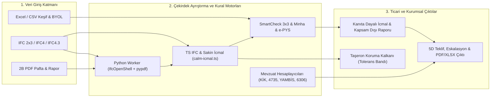

# BIMMetraj (TeklifPro) — Bütüncül Teknik Analiz, Hesaplama Motoru Doğrulaması, GAP / BUG / SEO / GEO Denetimi ve Rakip Karşılaştırma Raporu

**Tarih:** 21 Ekim 2026  
**İncelenen Sürüm:** `Rev. 39` (`docs/rev39-handoff` @ `fd32f8b`, `main` @ `420008e`)  
**Hesaplama Baseline:** `BIM-CALC-2026-10-19.33` · **Yetenek Kaydı:** `BIM-CAP-2026-10-17.11`  
**Denetim Kısıtı:** Salt-okunur analiz (`0` kod değişikliği, paylaşımlı yerel veritabanlarına dokunulmadı)

> [!IMPORTANT]
> **Yönetici Özeti:** BIMMetraj, Türkiye AEC (Mimarlık, Mühendislik ve İnşaat) pazarında **openBIM (IFC 2x3 / IFC4 / IFC4.3) 3B model tabanlı metraj (QTO)** ile **Türkiye kamu/özel sektör ihale mevzuatını (ÇŞB 2026 Poz, 4734 KİK m.38 ADT, 4735 Fiyat Farkı, YAMBİS, 6306 Kat Karşılığı KDV ve 5 Ağustos 2026 RG 33331 e-PYS)** aynı çatı altında birleştiren **tek bulut-yerli (cloud-native) platformdur**.  
> Yapılan otomatik testlerde **TypeScript (`tsc --noEmit`: 0 hata)**, **Python IFC/PDF worker (`pytest`: 60/60 geçti)** ve **27 birim/altın test paketi (`245/245` test geçti)** eksiksiz doğrulanmıştır. Hesaplama motorlarının matematiksel formülleri yürürlükteki resmî tebliğ ve yönetmeliklerle kuruşuna kadar uyumludur. Bununla birlikte, son revizyonlarda (`Rev. 36–39`) eklenen yapısal malzeme sınıflandırıcısında **kritik bir `"Gazbeton"` alt-dizgi çakışması (`BUG-01`)**, örnek proje (`st-statik-tablo-9-2`) satır ayrıştırma hatası (`BUG-02`), tarayıcı-sunucu IFC ayrıştırıcı uyumsuzluğu (`BUG-04`) ve statik JSON-LD ile Yetenek Kaydı (`registry.ts`) arasında **SEO/GEO gerçeklik kapısı kaymaları (`SEO-01`, `SEO-02`)** tespit edilmiştir.

---

## 1. Projenin Mevcut Durumu ve Mimari Analiz

### 1.1 Sistem Mimarisi ve Bilgi Akışı



### 1.2 Otomatik Doğrulama ve Test Sağlığı
Kod tabanında hiçbir değişiklik yapılmadan çalıştırılan doğrulama paketlerinin sonuçları:

| Doğrulama Katmanı | Komut / Kapsam | Sonuç | Notlar |
| :--- | :--- | :--- | :--- |
| **TypeScript Tip Kontrolü** | `./node_modules/.bin/tsc --noEmit` | **BAŞARILI (`0` hata)** | Tüm istemci, sunucu ve IFC/SmartCheck modülleri tip güvenli. |
| **Python IFC & PDF Worker** | `workers/ifc/.venv/bin/python -m pytest workers/ifc -q` | **BAŞARILI (`60/60` geçti)** | `5.95s` içinde tamamlandı. `ifcopenshell` içinde 9 adet `datetime.utcnow()` deprecation uyarısı mevcut. |
| **TS Hesaplama, IFC, SmartCheck & SEO/GEO Testleri** | `./node_modules/.bin/tsx --test` (27 test dosyası) | **BAŞARILI (`245/245` geçti)** | KİK ADT, 4735 Fiyat Farkı, Kat Karşılığı, YAMBİS, Pre-BIM, Minha, 3×3, e-PYS, ISO 19650, Sakin İcmal ve SEO/GEO testleri geçti. |
| **Canlı Ortam (Prod) Senkronizasyonu** | `https://bimmetraj.com` (Coolify) | **KISMİ KAYMA (`Rev. 35` vs `Rev. 39`)** | Yerel repo `Rev. 39` (`fd32f8b`) seviyesindedir; canlı sunucu son olarak `Rev. 35` (`9c59971`) seviyesinde doğrulanmıştır. `Rev. 36–39` Coolify deploy beklemektedir. |

---

## 2. Hesaplama Motorlarının Matematiksel ve Mevzuat Doğrulaması

Her bir hesaplama motoru kaynak kodu, altın testleri (golden tests) ve yürürlükteki resmî mevzuat / internet kaynakları ile çapraz kontrol edilmiştir:

### 2.1 4734 KİK m.38 & Kamu İhale Genel Tebliği m.45.1.1 Aşırı Düşük Teklif (ADT) Motoru
- **Modül:** [`kik-adt.ts`](file:///Users/hazarvolgaekiz/dev/products/bimplanacademy/TeklifPro-repo/src/lib/kik-adt.ts#L1-L260) · **Test:** [`kik-adt.test.ts`](file:///Users/hazarvolgaekiz/dev/products/bimplanacademy/TeklifPro-repo/src/lib/calculators/kik-adt.test.ts#L1-L98)
- **Mevzuat ve Matematiksel Doğrulama:**
  1. **İlk Ayıklama Bandı:** Yaklaşık Maliyetin ($\text{YM}$) $\%120$'sinin üzerindeki (`> 1.20 * YM`) ve $\%40$'ının altındaki (`< 0.40 * YM`) teklifler elenir ([`kik-adt.ts`](file:///Users/hazarvolgaekiz/dev/products/bimplanacademy/TeklifPro-repo/src/lib/kik-adt.ts#L105-L108)).
  2. **Birinci Ortalama ($Tort_1$) ve Standart Sapma ($\sigma$):** Örneklem standart sapması ($\sqrt{\frac{\sum (x_i - Tort_1)^2}{n - 1}}$) kullanılır ve Tebliğ m.45.1.1'e uygun olarak $Tort_1$, $\sigma$ ve $Tort_2$ **2 ondalık basamağa (`round2`)**, $C$ ve $K$ **3 ondalık basamağa (`round3`)** yuvarlanır ([`kik-adt.ts`](file:///Users/hazarvolgaekiz/dev/products/bimplanacademy/TeklifPro-repo/src/lib/kik-adt.ts#L121-L154)).
  3. **$K$ Katsayısı ve Sınır Değer ($SD$) Formülü:**
     - $C < 0.60 \implies K = C$
     - $0.60 \le C \le 1.00 \implies K = \frac{3.2C - C^2 - 0.6}{C + 1}$
     - $C > 1.00 \implies K = \frac{C^2 - 0.8C + 1.4}{C + 1}$
     - $SD = \text{round2}\left(\frac{K \times Tort_2}{C \times N}\right)$ ve eğer $SD < 0.40 \times \text{YM}$ ise $SD = 0.40 \times \text{YM}$ tabanı uygulanır ([`kik-adt.ts`](file:///Users/hazarvolgaekiz/dev/products/bimplanacademy/TeklifPro-repo/src/lib/kik-adt.ts#L142-L162)).
  4. **Resmî Tebliğ 45.2 Sayısal Örneği ile Kuruş Doğrulaması:** $\text{YM} = 100.000\text{ TL}$, $N = 1.20$, 12 geçerli teklif için motorun ürettiği değerler: $Tort_1 = 66.270,00$, $\sigma = 20.317,05$, $Tort_2 = 63.237,50$, $C = 0,632$, $K = 0,627$ ve **$SD = 52.281,00\text{ TL}$** (Resmî Tebliğ sonucu ile **fark: $0,00\text{ TL}$**).
  5. **Tebliğ m.45.1.2 Pareto ($\%80$) Sıralı İş Kalemleri:** Teklif kalemleri tutara göre küçükten büyüğe sıralanıp kümülatif $\%80$ eşiğine kadar açıklama istenecek kalemler ve malzeme/işçilik sapma bandı doğru ayrıştırılmaktadır ([`kik-adt.ts`](file:///Users/hazarvolgaekiz/dev/products/bimplanacademy/TeklifPro-repo/src/lib/kik-adt.ts#L191-L259)).
- **Sonuç:** **Tam Doğru (%100 Mevzuat Uyumlu).**

### 2.2 4735 Sayılı Kanun m.8 Yapım İşleri Fiyat Farkı Motoru
- **Modül:** [`price-escalation.ts`](file:///Users/hazarvolgaekiz/dev/products/bimplanacademy/TeklifPro-repo/src/lib/price-escalation.ts#L1-L283) · **Test:** [`price-escalation.test.ts`](file:///Users/hazarvolgaekiz/dev/products/bimplanacademy/TeklifPro-repo/src/lib/calculators/price-escalation.test.ts#L1-L78)
- **Mevzuat ve Matematiksel Doğrulama:**
  - 2013/5217 sayılı Bakanlar Kurulu Kararı ve 2025/10132 değişikliklerine uygun olarak $F = A_n \times B \times (P_n - 1)$ formülü, $B = 0.90$ sabit katsayısı ve $\sum w_i = 1.00$ ($\pm 0.001$ tolerans) ağırlık kontrolü doğru uygulanmaktadır ([`price-escalation.ts`](file:///Users/hazarvolgaekiz/dev/products/bimplanacademy/TeklifPro-repo/src/lib/price-escalation.ts#L155-L215)).
  - ÇŞB 2026 kitabındaki **21 resmî TÜİK alt endeks kodu** (`YI-UFE`, `16`, `19.20`, `22`, `23.1`..`23.6`, `24.1`..`24.4`, `25`, `27`, `28`, `ASGARİ_UCRET` vb.) eksiksiz tanımlanmıştır ([`price-escalation.ts`](file:///Users/hazarvolgaekiz/dev/products/bimplanacademy/TeklifPro-repo/src/lib/price-escalation.ts#L31-L55)).
- **Tespit Edilen Eksik/Geliştirme Noktası (`GAP-04`):** Fiyat Farkı Esasları m.6 uyarınca **iş programının gerisinde kalınan (cezalı) dönemlerde** uygulama ayı endeksi ile iş programına göre gerçekleştirilmesi gereken ayın endeksinden **düşük olanının** ($\min(G_{\text{program}}, G_{\text{uygulama}})$) alınması kuralı ve **avans mahsubu düşümü** henüz motorda modellenmemiştir.

### 2.3 Kat Karşılığı Arsa Payı, Müteahhit Kârı ve 6306 KDV Motoru
- **Modül:** [`kat-karsiligi.ts`](file:///Users/hazarvolgaekiz/dev/products/bimplanacademy/TeklifPro-repo/src/lib/kat-karsiligi.ts#L1-L240) · **Test:** [`kat-karsiligi.test.ts`](file:///Users/hazarvolgaekiz/dev/products/bimplanacademy/TeklifPro-repo/src/lib/kat-karsiligi.test.ts#L1-L108)
- **Mevzuat ve Matematiksel Doğrulama:**
  - **5359 ve 7346 sayılı Cumhurbaşkanı Kararları (01.04.2022 sonrası ruhsatlar):** Konut teslimlerinde kademeli (dilimli/marginal) KDV uygulanmaktadır. [`konutKdv`](file:///Users/hazarvolgaekiz/dev/products/bimplanacademy/TeklifPro-repo/src/lib/kat-karsiligi.ts#L76-L86) fonksiyonu net alanı $150\text{ m}^2$ üzerindeki konutlarda ilk $150\text{ m}^2$'lik dilimi $\%1$ (6306 kentsel dönüşüm) veya $\%10$ (genel), aşan kısmı ($\text{netArea} - 150$) ise $\%20$ üzerinden dilimli olarak doğru hesaplamaktadır. Ticari bağımsız bölümler doğrudan $\%20$ KDV'ye tabidir.
  - **VUK m.267 (İkinci Sıra — Maliyet Bedeli Esası) & KDV Genel Uygulama Tebliği (I/B-8.2):** Arsa sahibine bırakılan bağımsız bölümler için birim inşaat maliyeti üzerine toptan satışta $+\%5$, perakende satışta $+\%10$ emsal kâr marjı eklenerek (`emsalRate`) KDV matrahı doğru oluşturulmaktadır ([`kat-karsiligi.ts`](file:///Users/hazarvolgaekiz/dev/products/bimplanacademy/TeklifPro-repo/src/lib/kat-karsiligi.ts#L140-L157)).
- **Sonuç:** **Tam Doğru (%100 Mevzuat Uyumlu).**

### 2.4 YAMBİS Yetki Belgesi Sınıflandırma Motoru (RG 30702 / 31301 / 32330)
- **Modül:** [`yambis-classification.ts`](file:///Users/hazarvolgaekiz/dev/products/bimplanacademy/TeklifPro-repo/src/lib/yambis-classification.ts#L1-L290) · **Test:** [`yambis-classification.test.ts`](file:///Users/hazarvolgaekiz/dev/products/bimplanacademy/TeklifPro-repo/src/lib/yambis-classification.test.ts#L1-L115)
- **Mevzuat ve Matematiksel Doğrulama:**
  - 2 Ekim 2020 tarihli (RG 31301) değişiklikle genişletilen **14 yetki belgesi grubu** (`A, B, B1, C, C1, D, D1, E, E1, F, F1, G, G1, H`) ve 2026 yılı III. ve IV. Sınıf yapı yaklaşık birim maliyetlerinin ortalaması ($27.516,67\text{ TL/m}^2 \times 45.000\text{ m}^2 = 1.238.250.000\text{ TL}$ Yapı Sınır Bedeli) doğru kodlanmıştır ([`yambis-classification.ts`](file:///Users/hazarvolgaekiz/dev/products/bimplanacademy/TeklifPro-repo/src/lib/yambis-classification.ts#L28-L82)).
  - Ekonomik ve mali yeterlik oranları (Cari Oran $\ge 0.75$, Öz Sermaye Oranı $\ge 0.15$, Kısa Vadeli Banka Borçları / Öz Sermaye $< 0.75$, Banka Referans Mektubu $\ge \%5$, Ciro şartı `E/E1` için $\%10$, `D1..A` için $\%15$) ve `G/G1/H` gruplarının mali yeterlik muafiyeti Yönetmelik m.12–16 ile birebir örtüşmektedir.
- **Sonuç:** **Tam Doğru (%100 Mevzuat Uyumlu).**

### 2.5 Pre-BIM İmar Fizibilite & 2026 Villa Maliyet Dağılım Motoru
- **Modül:** [`pre-bim-feasibility.ts`](file:///Users/hazarvolgaekiz/dev/products/bimplanacademy/TeklifPro-repo/src/lib/pre-bim-feasibility.ts#L1-L260) · **Test:** [`pre-bim-feasibility.test.ts`](file:///Users/hazarvolgaekiz/dev/products/bimplanacademy/TeklifPro-repo/src/lib/pre-bim-feasibility.test.ts#L1-L92)
- **Mevzuat ve Matematiksel Doğrulama:**
  - Planlı Alanlar İmar Yönetmeliği m.5/8 ve m.22 uyarınca emsal harici alanların toplam emsal alanının $\%30$'unu aşamaması (`MAX_EMSAL_EXEMPT_RATIO = 0.30`), TAKS, KAKS ve kat adedi kontrolleri doğru çalışmaktadır ([`pre-bim-feasibility.ts`](file:///Users/hazarvolgaekiz/dev/products/bimplanacademy/TeklifPro-repo/src/lib/pre-bim-feasibility.ts#L168-L235)).
  - 27 imalat kalemli 2026 piyasa referans dağılımı (`4.135.752,77 TL`, toplam pay $\%100.00$) tutarlıdır.

### 2.6 SmartCheck Minha, TS 500 Kesişim, 3×3 Tolerans ve RG 33331 e-PYS Motorları
- **Modüller:** [`minha.ts`](file:///Users/hazarvolgaekiz/dev/products/bimplanacademy/TeklifPro-repo/src/smartcheck/rules/minha.ts#L1-L150), [`three-by-three.ts`](file:///Users/hazarvolgaekiz/dev/products/bimplanacademy/TeklifPro-repo/src/smartcheck/rules/three-by-three.ts#L1-L130), [`epys.ts`](file:///Users/hazarvolgaekiz/dev/products/bimplanacademy/TeklifPro-repo/src/smartcheck/rules/epys.ts#L1-L320), [`iso19650.ts`](file:///Users/hazarvolgaekiz/dev/products/bimplanacademy/TeklifPro-repo/src/smartcheck/rules/iso19650.ts#L1-L245)
- **Doğrulama:**
  - **Minha Kuralları:** `CSB_2026` ($0.50\text{ m}^2$ boşluk eşiği + denizlik/lento/söve geri dönüş eklemesi), `DIN_18350` ($2.50\text{ m}^2$ eşiği) ve `CUSTOM_CONTRACT` profilleri ile TS 500 döşeme–kiriş–kolon düğüm noktası mükerrer hacim düşümü matematiksel olarak doğrudur.
  - **3×3 Kuralları:** Şirket kalite politikası olan $\le \%3.00$ QTO sapma toleransı ve TS 500 Çizelge 9.3 paspayı eşikleri (döşeme $15\text{ mm}$, iç kolon/kiriş $20\text{ mm}$, dış cephe/temel $25\text{ mm}$, Eurocode 2 XC3 $35\text{ mm}$) doğru çalışmaktadır. *(Not: `ACI_318` seçildiğinde kural bilerek pas geçilmektedir).*
  - **RG 33331 e-PYS & ISO 19650-2:** EK-1..EK-7 ve EK-9 Tablo 9.1 (Mimari 21 satır) / Tablo 9.2 (Diğer Disiplinler 16 satır) kontrolleri gerçek IFC/PDF çıkarım bayraklarına bağlanmıştır; kanıt bulunmayan maddeler sahte `PASS` üretmek yerine dürüstçe `MANUAL_REVIEW` olarak işaretlenmektedir.

---

## 3. Tespit Edilen Somut BUG Raporu (Kod Kanıtlı)

Aşağıdaki 6 hata doğrudan kaynak kod incelemesi sırasında tespit edilmiş ve kök nedenleri doğrulanmıştır:

### `BUG-01` [YÜKSEK ÖNCELİK] — `"Gazbeton"` / `"Gaz beton"` Malzemesinin `"beton"` Alt-Dizgisi Nedeniyle C30/37 Betonarme Olarak Yanlış Sınıflandırılması
- **Konum:** [`structural-material.ts`](file:///Users/hazarvolgaekiz/dev/products/bimplanacademy/TeklifPro-repo/src/ifc/structural-material.ts#L21-L58)
- **Kök Neden:**
  ```ts
  const CONCRETE_PATTERN = /beton|concrete/i;
  const MASONRY_PATTERN = /tuğla|tugla|briket|ytong|bims|gazbeton|gaz beton|masonry|brick|block/i;
  ```
  [`classifyStructuralMaterial()`](file:///Users/hazarvolgaekiz/dev/products/bimplanacademy/TeklifPro-repo/src/ifc/structural-material.ts#L50-L58) fonksiyonunda `allConcrete` kontrolü `allMasonry` kontrolünden **önce** (satır 54 vs satır 57) çalışmaktadır. `"Gazbeton"` ve `"Gaz beton"` kelimeleri içinde `"beton"` alt-dizgisi geçtiği için `CONCRETE_PATTERN.test("Gazbeton")` **`true`** döndürmektedir!
- **Etki:**
  1. Malzemesi `"Gazbeton"` veya `"Gaz beton"` olan tüm `IfcWall` elemanları kâgir duvar (`kind: "masonry"`, Poz `15.225.1004` — $2.950\text{ TL/m}^3$) yerine **C30/37 Betonarme (`kind: "concrete"`, Poz `15.150.1006` — $3.450\text{ TL/m}^3$)** olarak sınıflandırılmakta ve birim fiyatı $\%16,9$ fazla hesaplanmaktadır.
  2. Üstelik `parseConcreteClass("Gazbeton")` `null` döndürdüğü ve `concreteClassDiffers(null)` `false` döndürdüğü için kullanıcıya hiçbir sınıf uyarısı da gösterilmemektedir.
  3. Bir döşeme veya kirişe yanlışlıkla `"Gazbeton"` malzemesi atanmışsa, `unplaced` (kapsam dışı) olması gerekirken betonarme icmaline dahil edilmektedir.
- **Önerilen Çözüm:** `CONCRETE_PATTERN` içinde `gaz\s*beton` dışlanmalı (`/^(?!.*gaz\s*beton).*(?:beton|concrete)/i`) veya `hasMasonry` kontrolü `allConcrete` kontrolünden önce değerlendirilmelidir.

### `BUG-02` [ORTA-YÜKSEK ÖNCELİK] — Statik Örnek Projesinde (`st-statik-tablo-9-2`) Taşıyıcı Perde ve Koruma Betonunun İcmal Dışı / Yanlış Fiyatlı Kalması
- **Konum:** [`calm-icmal.ts`](file:///Users/hazarvolgaekiz/dev/products/bimplanacademy/TeklifPro-repo/src/ifc/calm-icmal.ts#L512-L556) ve [`sample-projects.ts`](file:///Users/hazarvolgaekiz/dev/products/bimplanacademy/TeklifPro-repo/src/smartcheck/sample-projects.ts#L1098-L1146)
- **Kök Neden:**
  1. `st-statik-tablo-9-2` örnek projesinin 2. satırında `rawDescription: "IfcWall · ST-DVR-perde_20cm (Dış Cephe Taşıyıcı Perde — Paspayı Kontrolü)"` ve `rawPositionCode: "15.150.1005"` yer almaktadır; `formulaJson` içinde `materialLayers` dizisi yoktur.
  2. [`parseSmartCheckRowToPseudoElement()`](file:///Users/hazarvolgaekiz/dev/products/bimplanacademy/TeklifPro-repo/src/ifc/calm-icmal.ts#L535) `materialLayers` bulunmadığında `[desc]` dizisini malzeme katmanı olarak atar. Ancak açıklama metninde `"beton"` kelimesi geçmediği (`"Taşıyıcı Perde"` yazdığı) için `classifyStructuralMaterial("IfcWall", [desc])` bunu `kind: "unplaced"` olarak reddeder!
  3. Aynı örnek projenin 3. satırındaki `IfcCovering · ST-KPL-koruma_betonu` (`rawPositionCode: "15.390.1002"`) için `coveringPredefinedType` atanmadığından [`findCoveringRule()`](file:///Users/hazarvolgaekiz/dev/products/bimplanacademy/TeklifPro-repo/src/ifc/calm-icmal.ts#L451-L465) eşleşmez ve `cleanExplicitPoz` geri dönüşü (fallback) ile $980\text{ TL/m}^2$ yerine jenerik $450\text{ TL/m}^2$ birim fiyatla fiyatlandırılır.
- **Etki:** Kullanıcı arayüzünde resmi Statik örnek projesi (`st-statik-tablo-9-2`) açıldığında dış cephe betonarme perde duvar icmale girmeyip "Eşleştirilemeyen / Kapsam Dışı Eleman" olarak düşmektedir.

### `BUG-03` [ORTA ÖNCELİK] — Dayanım Sınıfı Belirtilmemiş Betonların ve Grobeton / Şap Betonunun Uyarı Üretmeden C30/37 Betonarmeye (`15.150.1006`) Atanması
- **Konum:** [`structural-material.ts`](file:///Users/hazarvolgaekiz/dev/products/bimplanacademy/TeklifPro-repo/src/ifc/structural-material.ts#L23-L42) ve [`calm-icmal.ts`](file:///Users/hazarvolgaekiz/dev/products/bimplanacademy/TeklifPro-repo/src/ifc/calm-icmal.ts#L784-L799)
- **Kök Neden:**
  - [`concreteClassDiffers(concreteClass)`](file:///Users/hazarvolgaekiz/dev/products/bimplanacademy/TeklifPro-repo/src/ifc/structural-material.ts#L61-L65) fonksiyonu `if (!concreteClass) return false;` satırı nedeniyle, malzemesi sadece `"Beton"`, `"Grobeton"`, `"Eğim Betonu"` veya `"C 25/30"` (`C` harfinden sonra boşluk bırakılmış) olan elemanlarda `concreteClass = null` döndüğünde **fiyat farkı uyarısı (`CONCRETE_CLASS_DIFFERS`) üretmemektedir**.
- **Etki:** Dayanım sınıfı yazılmamış betonlar veya C16/20 grobeton katmanları sessizce C30/37 yapısal betonarme ($3.450\text{ TL/m}^3$) olarak fiyatlandırılmaktadır.

### `BUG-04` [ORTA ÖNCELİK] — Tarayıcı İçi IFC Ayrıştırıcısı (`legacy-parser.ts`) ile Sunucu Python Ayrıştırıcısı (`ifc_extract.py`) Arasında Büyük Kapsam Farkı
- **Konum:** [`legacy-parser.ts`](file:///Users/hazarvolgaekiz/dev/products/bimplanacademy/TeklifPro-repo/src/ifc/parser/legacy-parser.ts#L108-L215) vs [`ifc_extract.py`](file:///Users/hazarvolgaekiz/dev/products/bimplanacademy/TeklifPro-repo/workers/ifc/ifc_extract.py#L46-L120)
- **Kök Neden:**
  - `legacy-parser.ts` (satır 108) yalnızca `IFCBEAM|IFCCOLUMN|IFCSLAB|IFCWALL|IFCWALLSTANDARDCASE|IFCWALLELEMENTEDCASE|IFCREINFORCINGBAR` varlıklarını yakalar; `IfcCovering`, `IfcStair`, `IfcStairFlight`, `IfcCurtainWall` varlıklarını görmezden gelir, `IfcRelAggregates` alt parçalarını bastırmaz ve üretilen `ParsedIfcElement` nesnelerine `materialLayers` dizisini bağlamaz.
  - Ayrıca yerel git deposunda henüz uzak sunucuya (origin) itilmemiş `fix/ifc-browser-quota-alert` (`b9153eb`) dalında tespit edildiği üzere, e-postası doğrulanmamış veya aboneliği olmayan kullanıcıların tarayıcı analizleri `/api/ifc/browser-analyses` uç noktasından `403` aldığında sessizce kaybolabilmektedir.
- **Etki:** Sunucu worker'ı yerine tarayıcı önizlemesi üzerinden `CalmIfcWorkspace` çalıştırıldığında elemanlarda `materialLayers` bulunmadığı için tamamı `MISSING_MATERIAL` gerekçesiyle icmal dışına düşmektedir.

### `BUG-05` [DÜŞÜK-ORTA ÖNCELİK] — Mükerrer (Duplicate) `GlobalId` Bulunan IFC Modellerinde Kapsam Dışı Elemanların Tekilleştirme (`Set`) Sırasında Yutulması
- **Konum:** [`calm-icmal.ts`](file:///Users/hazarvolgaekiz/dev/products/bimplanacademy/TeklifPro-repo/src/ifc/calm-icmal.ts#L838-L845)
- **Kök Neden:** Python worker (`ifc_extract.py`) mükerrer GUID'li elemanları bilerek korurken, `calm-icmal.ts` içinde `seenUncoveredGuids = new Set(baseReport.uncoveredElements.map((u) => u.globalId))` yalnızca `globalId` anahtarıyla tekilleştirme yaptığı için aynı GUID'e sahip ikinci kapsam dışı elemanı (`mergedUncovered`) düşürmektedir.

### `BUG-06` [DÜŞÜK ÖNCELİK] — PDF e-İmza (`/Sig`) Sayfa Anotasyon Taramasının İlk 20 Sayfa ile Sınırlandırılması
- **Konum:** [`pdf_preflight.py`](file:///Users/hazarvolgaekiz/dev/products/bimplanacademy/TeklifPro-repo/workers/ifc/pdf_preflight.py#L112)
- **Kök Neden:** [`_has_esignature()`](file:///Users/hazarvolgaekiz/dev/products/bimplanacademy/TeklifPro-repo/workers/ifc/pdf_preflight.py#L97-L120) fonksiyonu kök `/AcroForm/Fields` ağacını tam taramakta, ancak sayfa bazlı `/Annots` içindeki `/Sig` kontrollerinde `for page in reader.pages[:20]:` dilimlemesi yapmaktadır. 20 sayfayı aşan statik/mekanik hesap raporlarında son sayfada yer alan sayfa-bazlı imza anotasyonları kaçırılabilir.

---

## 4. Fonksiyonel ve Operasyonel GAP (Eksiklik) Raporu

| Kod | Alan | Mevcut Durum | Eksiklik (GAP) | Öncelik |
| :--- | :--- | :--- | :--- | :--- |
| **`GAP-01`** | **ÇŞB 2026 Poz Kataloğu & Poz Kapsamı** | Yerleşik tohum katalog (`csb-2026-seed.json`) yalnızca **103 örnek poz** içeriyor; tam katalog BYOL (kullanıcı XLSX yüklemesi) bekliyor. Sakin İcmal (`calm-icmal.ts`) ise yalnızca **7 çekirdek poza** (`15.150.1006`, `15.225.1004`, `15.390.1002`, `15.415.1201`, `15.275.1101`, `15.540.1201`, `15.390.1101`) otomatik yerleştiriyor. | Mimari/İnşaat projelerinde sık kullanılan kapı (`IfcDoor`), pencere (`IfcWindow`), korkuluk (`IfcRailing`), çatı (`IfcRoof`), temel (`IfcFooting`), su/ısı yalıtımı ve asma tavan kalemleri için otomatik poz eşleme kuralları henüz yok (`out_of_scope` olarak ayrılıyor). | **P0** |
| **`GAP-02`** | **Beton Dayanım Sınıfına Göre Dinamik Poz Seçimi** | `structural-material.ts` içindeki `parseConcreteClass()` `C25/30`, `C35/45` vb. sınıfları başarıyla ayrıştırıyor ancak `calm-icmal.ts` tamamını tek bir poza (`15.150.1006` — C30/37) yerleştirip sadece uyarı üretiyor. | Tohum katalogda zaten mevcut olan `15.150.1005` (C25/30) veya C35/45 pozlarına dinamik yönlendirme yapılmalı; uyarı yalnızca katalogda karşılığı olmayan sınıflar için üretilmeli. | **P0** |
| **`GAP-03`** | **Gerçek Hakediş (Ara Hakediş / Yeşil Defter / Ataşman) Döngüsü** | Platformda ihale öncesi keşif, teklif ve tek dönemlik 4735 fiyat farkı hesabı mevcut. | Türkiye pazarındaki OSKA/AMP standardı olan **Kümülatif Ara Hakediş (Hakediş No 1..N), Yeşil Defter, Metraj İcmali, Mukayeseli Keşif (İş Artışı/Eksilişi) ve Kesin Hesap** tabloları henüz mevcut değil. | **P1** |
| **`GAP-04`** | **4735 Fiyat Farkı Cezalı Çalışma & Avans Mahsubu** | `price-escalation.ts` temel $F = A_n \times B \times (P_n - 1)$ formülünü hesaplıyor. | İş programına göre gecikilen (cezalı) aylarda $\min(\text{Endeks}_{\text{program}}, \text{Endeks}_{\text{uygulama}})$ karşılaştırması ve avans mahsubu düşümü eksik. | **P1** |
| **`GAP-05`** | **Uzman Doğrulaması (`L2 -> L3` Kanıt Kapısı)** | [`registry.ts`](file:///Users/hazarvolgaekiz/dev/products/bimplanacademy/TeklifPro-repo/src/capabilities/registry.ts#L50-L71) içindeki tüm canlı ve pilot yetenekler `L1` veya `L2` seviyesinde (`reviewer: null`). | İnşaat mühendisi / mimar / YMM imzalı altın örnek doğrulaması (`L3`) henüz hiçbir modüle eklenmediği için kurumsal ihale şartnamelerinde "bağımsız doğrulanmamıştır" şerhi zorunlu kalıyor. | **P1** |
| **`GAP-06`** | **EKAP Açılış Tutanağı & KİK Savunma Dosyası** | `kik-adt.ts` sınır değeri ve $\%80$ Pareto iş kalemlerini hesaplıyor. | EKAP ihale açılış tutanağı (PDF/XLSX) otomatik ayrıştırma ve proforma fatura / analiz formatında resmi KİK aşırı düşük savunma paketi çıktısı henüz yok (`roadmap`). | **P2** |
| **`GAP-07`** | **Sunucu Tarafı PDF/A-2b Dönüştürme & 3B Görsel Önizleme** | `pdf_preflight.py` yalnızca üstveri ve `/Sig` ön kontrolü yapıyor; IFC tarafında ise metin/tablo tabanlı Sakin İcmal sunuluyor. | Ghostscript/veraPDF ile gerçek PDF/A-2b dönüştürme ve tarayıcıda seçilen kapsam dışı elemanı (`globalId`) 3B model üzerinde vurgulayan hafif bir WebGL/IFC görüntüleyici eksik. | **P2** |
| **`GAP-08`** | **Canlı Ortam (Coolify) Dağıtım ve Otomasyon Kayması** | Git deposu `Rev. 39` seviyesinde; `fix/ifc-browser-quota-alert` yerel dalda bekliyor. | Canlı ortam (`bimmetraj.com`) `Rev. 35`'te kalmış durumda; Coolify GitHub App/SSH anahtarı ve otomatik healthcheck rollback hattı henüz tamamlanmamış. | **P0** |

---

## 5. SEO ve GEO (Generative Engine Optimization) Denetim Raporu

### 5.1 Mevcut Güçlü Yönler
- **Anti-Soft-404 Mimarisi:** [`app.ts`](file:///Users/hazarvolgaekiz/dev/products/bimplanacademy/TeklifPro-repo/src/server/app.ts#L266-L281) ve [`web-hardening.ts`](file:///Users/hazarvolgaekiz/dev/products/bimplanacademy/TeklifPro-repo/src/server/security/web-hardening.ts#L102-L108) bilinmeyen SPA rotalarında gerçek HTTP `404` kodu ve `<meta name="robots" content="noindex, nofollow" />` döndürerek Google Search Console soft-404 cezalarını önlemektedir.
- **Rota Bazlı Sunucu `<head>` Enjeksiyonu:** [`route-meta.ts`](file:///Users/hazarvolgaekiz/dev/products/bimplanacademy/TeklifPro-repo/src/server/security/route-meta.ts#L201-L246) 15 genel/auth rotası için sunucu tarafında özgün `<title>`, `<meta name="description">`, `canonical`, `og:*` ve `<noscript><main>` içeriği üretmekte; `#faq-jsonld` şemasını yalnızca `/` ana sayfasında tutmaktadır.
- **Yetenek Kaydından Türetilen `llms.txt` ve `llms-full.txt`:** [`web-hardening.ts`](file:///Users/hazarvolgaekiz/dev/products/bimplanacademy/TeklifPro-repo/src/server/security/web-hardening.ts#L133-L214) doğrudan `CAPABILITY_REGISTRY` üzerinden kanıt seviyeli (`L1/L2`) makine-okunur özet üretmektedir.

### 5.2 Tespit Edilen SEO ve GEO Bulguları

| Kod | Kategori | Konum | Bulgu ve Etki | Çözüm Önerisi |
| :--- | :--- | :--- | :--- | :--- |
| **`SEO-01`** | **JSON-LD vs. Gerçeklik Kapısı Kayması (Kritik)** | [`index.html`](file:///Users/hazarvolgaekiz/dev/products/bimplanacademy/TeklifPro-repo/index.html#L63-L90) vs [`registry.ts`](file:///Users/hazarvolgaekiz/dev/products/bimplanacademy/TeklifPro-repo/src/capabilities/registry.ts#L154-L166) | `index.html` satır 63 ve 90'daki JSON-LD içinde *"WIP/SHARED/PUBLISHED/ARCHIVED CDE durum geçiş doğrulaması ... destekler"* denmektedir. Oysa `registry.ts` ve `llms.txt` içinde tam CDE durum geçişinin **henüz uygulanmadığı (Faz 2 yol haritasında olduğu)** açıkça yazılıdır. Arama motorları ve AI ajanları çelişkili yapısal veri okumaktadır. | `index.html` satır 63 ve 90'daki JSON-LD metinlerini `route-meta.ts` ve `registry.ts` ile birebir hizalayın. |
| **`SEO-02`** | **JSON-LD Katalog Büyüklüğü İddiası Kayması** | [`index.html`](file:///Users/hazarvolgaekiz/dev/products/bimplanacademy/TeklifPro-repo/index.html#L66) vs [`registry.ts`](file:///Users/hazarvolgaekiz/dev/products/bimplanacademy/TeklifPro-repo/src/capabilities/registry.ts#L193-L198) | `index.html` satır 66'da `SoftwareApplication.featureList` içinde *"ÇŞB 2026 18.848 Satır (6 Resmi Kitap) Birim Fiyat/Rayiç Kataloğu"* yazmaktadır; yerleşik tohumun 103 poz olduğu ve tam kataloğun BYOL ile yüklendiği belirtilmemiştir. | İfadeyi *"ÇŞB 2026 103 Poz Örnek Tohum + Kendi Lisansını Getir (BYOL) XLSX Katalog İçe Aktarımı"* olarak güncelleyin. |
| **`SEO-03`** | **Sabit (`Hardcoded`) Sitemap `lastmod` Tarihi** | [`web-hardening.ts`](file:///Users/hazarvolgaekiz/dev/products/bimplanacademy/TeklifPro-repo/src/server/security/web-hardening.ts#L112) | `sitemapXml()` tüm sayfalar için sabit `const lastmod = '2026-10-18';` döndürmektedir. | `lastmod` değerini `CALC_REVIEW_META` / `CAPABILITY_REGISTRY_VERSION` tarihinden veya sunucu derleme zamanından dinamik üretin. |
| **`SEO-04`** | **`PUBLIC_APP_URL` Eksikliğinde SEO/GEO Kapanması** | [`app.ts`](file:///Users/hazarvolgaekiz/dev/products/bimplanacademy/TeklifPro-repo/src/server/app.ts#L245-L275) | Ortam değişkenlerinde `PUBLIC_APP_URL` unutulursa `/sitemap.xml`, `/robots.txt`, `/llms.txt`, `/llms-full.txt` `404` dönmekte ve `injectRouteMeta()` devre dışı kalmaktadır. | `PUBLIC_APP_URL` tanımlı olmadığında varsayılan olarak `https://bimmetraj.com` (veya güvenli `req` host doğrulaması) geri dönüşü (fallback) kullanın. |
| **`SEO-05`** | **Hesaplayıcı ve Sözlük Rotalarında Özel JSON-LD Eksikliği** | [`route-meta.ts`](file:///Users/hazarvolgaekiz/dev/products/bimplanacademy/TeklifPro-repo/src/server/security/route-meta.ts#L201-L246) | En yüksek organik arama hacmine sahip `/hesaplayicilar/kik-asiri-dusuk-teklif`, `/hesaplayicilar/fiyat-farki-4735` ve `/bim-sozlugu` sayfalarında sayfaya özel `BreadcrumbList`, `DefinedTermSet` veya `HowTo` JSON-LD şeması bulunmamaktadır. | `injectRouteMeta` içine `/bim-sozlugu` için `DefinedTermSet` (12 terim) ve hesaplayıcılar için `BreadcrumbList` + `SoftwareApplication` alt şeması ekleyin. |
| **`GEO-01`** | **AI Bot Yönergeleri ve `llms.txt` Keşfedilebilirliği** | [`web-hardening.ts`](file:///Users/hazarvolgaekiz/dev/products/bimplanacademy/TeklifPro-repo/src/server/security/web-hardening.ts#L117-L120), [`index.html`](file:///Users/hazarvolgaekiz/dev/products/bimplanacademy/TeklifPro-repo/index.html#L16-L20) | `robots.txt` içinde `OAI-SearchBot`, `GPTBot`, `ClaudeBot`, `PerplexityBot`, `Google-Extended` için açık izin blokları yok; `index.html` içinde `<link rel="alternate" type="text/plain" href="/llms.txt" />` etiketi bulunmuyor. | `robots.txt` ve `index.html` `<head>` içine `llms.txt` / `llms-full.txt` referanslarını ve AI arama botu kurallarını ekleyin. |
| **`GEO-02`** | **`<noscript>` Gövdesi vs. Readability/RAG Kazıyıcıları** | [`route-meta.ts`](file:///Users/hazarvolgaekiz/dev/products/bimplanacademy/TeklifPro-repo/src/server/security/route-meta.ts#L159-L170) | Sunucu metni `<noscript><main>...</main></noscript>` içine gömülmektedir. Birçok RAG/AI içerik çıkarıcısı (Trafilatura, Readability.js) HTML ayrıştırırken `<noscript>` etiketlerini tamamen siler. | `<noscript>` yerine, `<div id="root">...</div>` içine sunucu tarafında semantik ön-render HTML basıp React yüklenince üzerine bindirmek (hydration veya açılışta temizlenen SSR içerik) AI alıntılanma oranını çok ciddi artıracaktır. |
| **`GEO-03`** | **Bölgesel (Local/GEO) ve Çok Dilli (`hreflang`) Sinyaller** | [`index.html`](file:///Users/hazarvolgaekiz/dev/products/bimplanacademy/TeklifPro-repo/index.html#L27-L51) | `Organization` şemasında yalnızca `"addressLocality": "İstanbul", "addressCountry": "TR"` mevcuttur; Türkiye'deki 81 il/bölge (`areaServed: "TR"`), `sameAs` kurumsal profilleri ve global pazar hedefi (`gelecekteki-global-konumlandırma.md` kapsamında DACH / DIN 18350, UK / RICS, Orta Doğu) için `hreflang` veya İngilizce özet sayfası henüz yoktur. | `Organization` ve `SoftwareApplication` şemalarına `"areaServed": "TR"`, `"knowsAbout": ["IFC 4.3", "RG 33331 e-PYS", "ÇŞB Birim Fiyat", "4734 KİK Sınır Değer", "TS 500"]` ekleyin. |

---

## 6. Türkiye ve Global Piyasa Rakip Karşılaştırma Analizi

BIMMetraj'ın konumu iki farklı rekabet ekseninin kesişim noktasındadır:
1. **Türkiye Yerel İhale & Hakediş Devleri:** OSKA Yazılım (`e-Hakediş Pro` / `OSKABULUT` / `OskaGPT`), AMP Yazılım (`AMP Kurumsal Hakediş` / `Kolay Metraj` / `hakedis.org`), İhale Pro.
2. **Global 5D BIM & QTO Platformları:** BEXEL Manager, RIB CostX (iTWO), Autodesk Takeoff (ACC), Kreo / Togal.AI.

### 6.1 Karşılaştırmalı Rekabet Matrisi

| Kriter / Yetenek | **BIMMetraj (TeklifPro)** | **OSKA (OSKABULUT / HakedişPlus)** | **AMP Yazılım (Kurumsal)** | **BEXEL Manager** | **RIB CostX** | **Autodesk Takeoff / Kreo** |
| :--- | :--- | :--- | :--- | :--- | :--- | :--- |
| **Mimari & Kurulum** | **%100 Web / Bulut-Yerli (SaaS)** | Masaüstü + Bulut (Hibrit) | Ağırlıklı Masaüstü + Web araçları | Masaüstü ağırlıklı (Enterprise) | Masaüstü / Sunucu | %100 Bulut (SaaS) |
| **Doğrudan IFC (2x3 / 4 / 4.3) QTO** | **Yerleşik (IfcOpenShell + Katmanlı `IfcCovering`)** | Harici CAD/Allplan eklentisiyle | Zayıf / Harici aktarımla | **Çok Güçlü (3D/4D/5D/6D)** | **Çok Güçlü (2D + 3D BIM)** | **Güçlü (3D + AI 2D)** |
| **5 Ağustos 2026 RG 33331 e-PYS & EK-9 Ön Kontrolü** | **Var (Tablo 9.1 / 9.2 + PDF/A + `/Sig`)** | Yok | Yok | Yok (Genel IDS/bSDD var) | Yok | Yok |
| **ÇŞB 2026 & Kamu Birim Fiyatları** | **103 Tohum + BYOL XLSX (SHA-256)** | **Tam Resmi Katalog (18.800+ Poz, Tüm Kurumlar)** | **Tam Resmi Katalog (Tüm İdareler)** | Yok (Manuel yüklenir) | Yok (Manuel yüklenir) | Yok |
| **4734 KİK ADT & 4735 Fiyat Farkı** | **Var (Tebliğ 45.1.1 + %80 Pareto + 4735)** | **Çok Güçlü (Tam EKAP + Savunma + Cezalı FF)** | **Çok Güçlü (Tam EKAP + Savunma + Cezalı FF)** | Yok | Yok | Yok |
| **Taşeron Koruma Kalkanı & Kat Karşılığı (6306 KDV)** | **Var (`IfcZone` Daire Cetveli + 6306 Dilimli KDV)** | Kısmi (Geleneksel metrajla) | Kısmi | Yok | Yok | Yok |
| **Ara Hakediş, Yeşil Defter & Kesin Hesap** | **Eksik (`GAP-03`)** | **Sektör Standardı (Tam)** | **Sektör Standardı (Tam)** | İlerleme bazlı (Uluslararası) | Workbook bazlı | Yok / ACC Cost ile |
| **Kanıt Disiplini (Açık Formül + Kapsam Dışı Raporu)** | **Çok Yüksek (Sakin İcmal + L1..L4 Kanıt Kapısı)** | Orta (Kara kutu raporlar) | Orta | Yüksek | Yüksek (Canlı Workbook) | Orta |

### 6.2 Stratejik Rekabet Okuması
1. **OSKA ve AMP'ye Karşı BIMMetraj'ın Üstünlüğü ("Mavi Okyanus" Alanı):**
   - OSKA ve AMP, 30 yıllık geçmişleriyle **4734/4735 kamu hakedişi, yeşil defter ve tam kurum poz veritabanlarında** tartışmasız pazar lideridir. Ancak her iki yazılım da **doğrudan açık BIM (IFC 4 / 4.3) okuma, çok katmanlı `IfcCovering` ayrıştırma, TS EN ISO 19650-2 ve 5 Ağustos 2026 RG 33331 e-PYS yapı ruhsatı ön kontrolü** konularında geleneksel 2B/eklenti dünyasında kalmıştır.
   - Ayrıca Türkiye'deki özel sektör konut/villa müteahhitlerinin en büyük kanayan yarası olan **"IFC modelden daire bazlı taşeron sözleşme tavanı (Taşeron Koruma Kalkanı) + 6306 Kat Karşılığı KDV + Pre-BIM İmar Fizibilitesi"** üçlüsü OSKA ve AMP'de bu bütünlükte mevcut değildir.
2. **Global Rakiplere (BEXEL, CostX, Autodesk Takeoff, Kreo) Karşı Üstünlüğü:**
   - Global 5D BIM araçları döviz bazlı yüksek lisans maliyetlerine ($\$2.500 - \$10.000+/\text{yıl}$) sahiptir, arayüzleri karmaşıktır ve **Türk mevzuatından (ÇŞB Poz, TS 500 kesişim/paspayı, Minha $0.50\text{ m}^2$, RG 33331 e-PYS, KİK m.38, 4735 Fiyat Farkı)** tamamen habersizdir.
   - Öte yandan `src/smartcheck/rules/minha.ts` içindeki `DIN_18350` ($2.50\text{ m}^2$ VOB/C) ve `three-by-three.ts` içindeki `EUROCODE_2` kuralları, `docs/agent-memory/gelecekteki-global-konumlandırma.md` belgesinde hedeflenen **ülke-bağımsız kural paketi (Rule-Pack Architecture)** vizyonunun şimdiden kod tabanında çalıştığını kanıtlamaktadır.

---

## 7. Genel Değerlendirme ve Stratejik Yol Haritası Önerisi (Mühendislik & Ürün Görüşü)

> [!TIP]
> **Genel Kanaat:** BIMMetraj, "her şeyi yaptığını iddia eden abartılı bir AI aracı" olmaktan çıkıp, `Rev. 26–39` arasındaki disiplinli çalışmayla **"neyi kanıtladığını ve neyi kapsam dışı bıraktığını şeffafça gösteren kanıta dayalı bir mühendislik masasına"** dönüşmüştür. Bu dürüstlük mimarisi (`CAPABILITY_REGISTRY` + `Sakin İcmal` + `Taşeron Koruma Kalkanı`), teknik ofis mühendislerinde güven oluşturmak için en doğru temeldir.

Projeyi bir üst lige taşımak için önerilen **4 Aşamalı Eylem Planı**:

### Aşama 1: Acil Kod ve Canlı Ortam Düzeltmeleri (1–3 Gün — "Sıfır Hata Kapısı")
1. **`BUG-01` ve `BUG-03` Çözümü (`structural-material.ts`):** `"Gazbeton"` / `"Gaz beton"` alt-dizgi çakışmasını düzeltin; dayanım sınıfı belirtilmemiş betonlarda (`concreteClass === null`) veya `"Grobeton"` ifadelerinde sessizce C30/37 atamak yerine uyarı (`CONCRETE_CLASS_DIFFERS` / grobeton ayrımı) üretin.
2. **`BUG-02` Çözümü (`calm-icmal.ts` & `sample-projects.ts`):** `st-statik-tablo-9-2` örnek projesindeki perde duvar ve koruma betonu satırlarına açık `materialLayers` ve `coveringPredefinedType` ekleyin; `calm-icmal.ts` içinde tanımlı C25/30 (`15.150.1005`) pozunu dinamik olarak destekleyin (`GAP-02`).
3. **`SEO-01` ve `SEO-02` Çözümü (`index.html`):** Statik JSON-LD içindeki CDE durum geçişi ve 18.848 satır katalog iddiasını `registry.ts` ile %100 uyumlu hale getirin.
4. **Coolify Canlı Dağıtımı (`GAP-08`):** `Rev. 36–39` değişikliklerini ve `fix/ifc-browser-quota-alert` dalını birleştirip `bimmetraj.com` canlı ortamını güncelleyin.

### Aşama 2: Çekirdek Ürün Derinleştirme (2–4 Hafta — "Teknik Ofisin Günlük Aracı")
1. **7 Pozdan 40+ Çekirdek Poza Geçiş (`GAP-01`):** `calm-icmal.ts` deterministik poz eşleştiricisine `IfcDoor`, `IfcWindow`, `IfcRailing`, `IfcRoof`, `IfcFooting`, ısı/su yalıtımı, asma tavan ve grobeton kurallarını ekleyin.
2. **Tarayıcı ve Sunucu IFC Ayrıştırıcı Birleşimi (`BUG-04`):** `legacy-parser.ts` ile `ifc_extract.py` arasındaki şema farkını kapatın; tarayıcı önizlemesinde de `IfcCovering` ve `materialLayers` desteğini sağlayın.
3. **4735 Cezalı Çalışma & Avans Mahsubu (`GAP-04`):** Fiyat farkı motoruna iş programı gecikme endeks karşılaştırmasını ($\min(E_{\text{program}}, E_{\text{uygulama}})$) ekleyin.

### Aşama 3: Kurumsal Güven & SEO/GEO Büyüme Kaldıraçları (1–2 Ay)
1. **İlk `L3` Uzman Onayları (`GAP-05`):** En az 3 çekirdek modül (KİK m.38 ADT, 4735 Fiyat Farkı, Minha/Sakin İcmal) için oda sicil numaralı bir inşaat mühendisi / teknik müşavir imzasıyla altın örnek doğrulaması alıp `registry.ts` içinde ilk `L3` rozetlerini açın.
2. **Ücretsiz Hesaplayıcı Kümesini Genişletme (Organik Trafik Mıknatısı):** Mevcut `/hesaplayicilar/kik-asiri-dusuk-teklif` ve `/hesaplayicilar/fiyat-farki-4735` yanına, halihazırda kod tabanında çalışan **YAMBİS Yetki Belgesi Grubu Hesaplayıcı (`yambis-classification.ts`)**, **6306 Kat Karşılığı KDV & Arsa Payı Hesaplayıcı (`kat-karsiligi.ts`)** ve **İmar / TAKS-KAKS Fizibilite Hesaplayıcı (`pre-bim-feasibility.ts`)** modüllerini de ücretsiz halka açık SEO sayfaları olarak açın. Bu üç araç Türkiye'de aylık on binlerce organik mühendis/müteahhit araması çeken yüksek dönüşümlü (lead-gen) araçlardır.

### Aşama 4: OSKA/AMP Bariyerini Aşan Hakediş & Global Kural Paketleri (2026 Q4 – 2027)
1. **Yeşil Defter & Ara Hakediş İhracı (`GAP-03`):** IFC metraj cetvelini tek tıkla standart "Yeşil Defter + Metraj İcmali + Mukayeseli Keşif" Excel şablonuna (OSKA/AMP içe aktarım formatlarıyla uyumlu) dönüştürün. Böylece teknik ofisler mevcut hakediş yazılımlarını bırakmak zorunda kalmadan BIMMetraj'ı **"BIM-to-Hakediş Köprüsü"** olarak satın alacaktır.
2. **Global Modüler Kural Paketleri (`Rule-Pack`):** `CSB_2026` yanındaki `DIN_18350` (DACH/Almanya VOB/C) ve `NRM2` (İngiltere RICS) paketlerini bağımsız dil/mevzuat profilleri haline getirerek global openBIM pazarına açılın.
